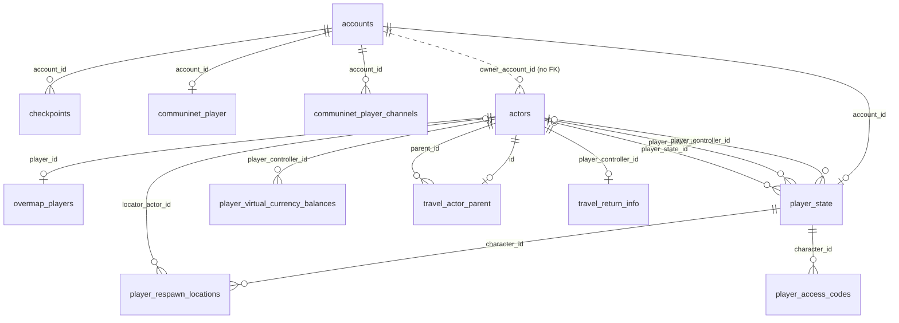
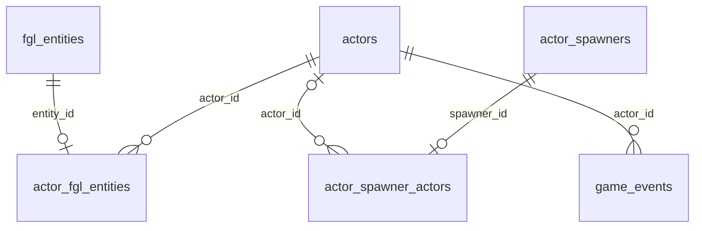
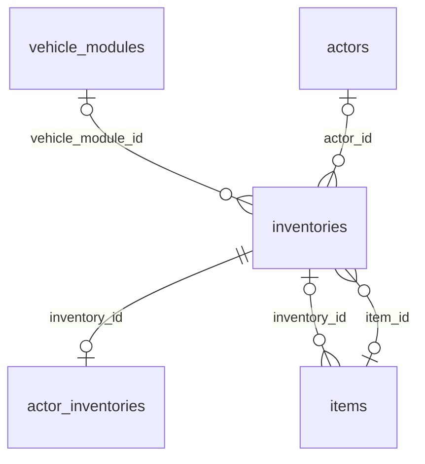
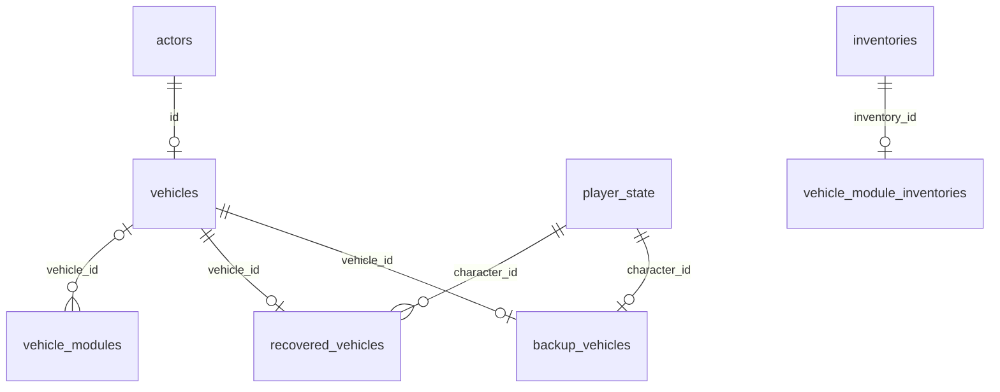
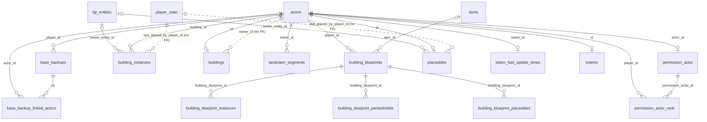
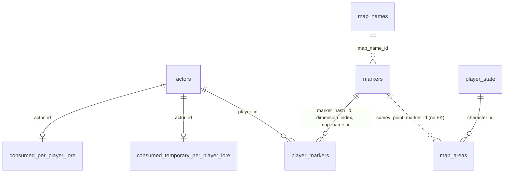
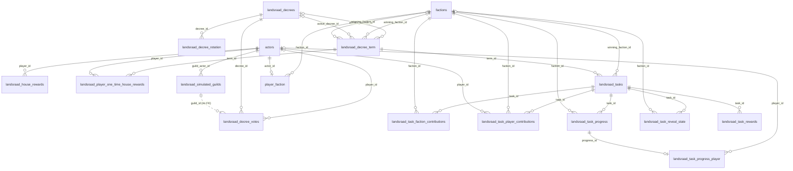
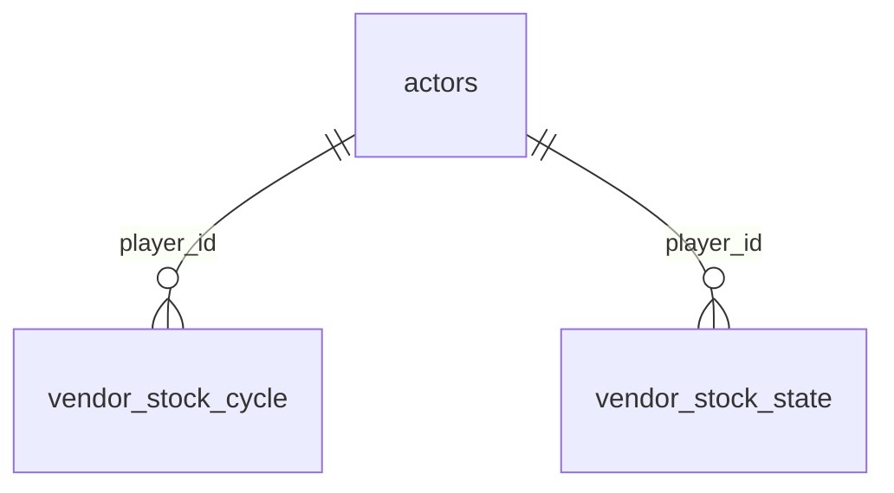

# The single-player save database: schema, relationships and who writes what

Status: research and reference, 2026-11-12. Structure only: this page holds table and column names, types, keys, indexes and relationships. No row, name, id, coordinate or item of any save is in it.

Related document: `save-database-trainer.md`, kept in the repository of a second program that reads these saves (named here only; it is not part of this repository). Where the two differ in scope: this page describes the database and the editor's use of it; the other adds that program's reads.

## 1. What this is, and where it comes from

The single-player game keeps its world in one SQLite database. This page describes that database as a database administrator would: every table and column, the keys and foreign keys, the indexes and the trigger, how the tables relate, what a program has to keep true when it writes, what the game rewrites on its own, and how the older layout differs from the newer one.

Sources, all read only:

1. `kit/schema/schema.sql` (the **older layout**): the CREATE statements of 94 tables, extracted on 2026-09-30 from a real single-player save, tag `kit/v0.9.0`.
2. A copy of a played save of 2026-11-11 (the **newer layout**), decoded to a scratch file and opened read-only and immutable. Only `sqlite_master`, `PRAGMA table_xinfo`, `PRAGMA foreign_key_list` and `PRAGMA index_list` were read. The newer layout has 97 tables.
3. The editor's code (`internal/ops`, `internal/save`, `kit/schema`) and its notes (`docs/single-player-files.md`, `docs/design/`, `docs/research/`).

Evidence tags used below: **V** verified (a program's code and tests, or notes made against real saves), **I** inferred from names and structure only, **U** unknown. A statement without a tag in the prose is V unless it says otherwise.

In numbers (newer layout): 97 application tables (95 STRICT, 62 WITHOUT ROWID, 16 with AUTOINCREMENT) plus SQLite's `sqlite_sequence` and `sqlite_stat1`; 460 columns; 103 foreign-key constraints (the older layout had 100); 89 index objects (55 created with CREATE INDEX, 34 automatic for UNIQUE constraints); one trigger; no view; `PRAGMA user_version` and `application_id` are both 0, so the file carries no layout stamp.

## 2. How the file is built

- **Container.** `game.db`, `game_prepatch.db` and `autosave\N.bak` are an 8-byte header (a little-endian 1, then the little-endian size of the payload) followed by a zlib stream whose payload is a SQLite 3 database (`kit/savefile`). Everything below is about the payload.
- **Typing.** Most tables are STRICT: SQLite refuses a value of the wrong type (a text where an INTEGER column is declared). `vehicles` and `applied_patches` are the two application tables that are not STRICT. `sqlite_sequence` and `sqlite_stat1` are SQLite's own.
- **JSON documents.** Several columns hold JSON: `actors.gas_attributes` and `actors.properties` (BLOB, SQLite JSONB), `fgl_entities.components` (BLOB, JSONB), `vehicle_modules.stats` (BLOB, JSONB), `loot_container_items.stats` (BLOB), and `items.stats` (TEXT, plain JSON). Section 10 lists the keys the programs use. A BLOB column holding JSONB must be written with a JSONB function (`jsonb(...)`, `jsonb_set(...)`); a text value in a BLOB column of a STRICT table is accepted by SQLite but is not what the game wrote.
- **Foreign keys.** 103 constraints, most of them `ON DELETE CASCADE` (deleting an actor removes its rows in dozens of tables), a few `ON DELETE SET NULL` (an entity owner, the character's actor ids, the Landsraad faction and decree references). Whether the game opens its own connection with `PRAGMA foreign_keys` on is **U**. The editor runs `PRAGMA foreign_key_check` before and after an edit and undoes an edit that adds a dangling reference.
- **The one trigger.** `actor_fgl_entities_cleanup_orphaned_entities`: after a row of `actor_fgl_entities` is deleted, the `fgl_entities` row of its `entity_id` is deleted too. This is how the entities of a deleted actor disappear.
- **References without a foreign key.** Some columns name another table's rows and are not constrained: `actors.owner_account_id` (accounts), `buildings.owner_id`, `building_instances.last_placed_by_player_id`, `placeables.last_placed_by_player_id`, `base_backups.last_edited_by_player_id`, `permission_actor.edited_by_player_id`, `recovered_vehicles.edited_by_player_id`, `landsraad_decree_votes.guild_id`, `player_faction_reputation` (both columns), `map_areas.survey_point_marker_id`, `player_state.pending_respawn_location_id` (a `player_respawn_locations.id`), and the `map` text columns that name a map. A write must keep these true by hand, because the database will not.
- **AUTOINCREMENT tables** (16): `accounts`, `actor_spawners`, `actors`, `base_backups`, `building_blueprints`, `dungeon_completion`, `factions`, `inventories`, `items`, `landsraad_decrees`, `lore_pickups`, `lore_pickups_temporary`, `player_state`, `specialization_keystones_map`, `tutorials`, `vehicle_modules`.

## 3. Ids, counters and invariants a write must respect

1. **One character, three actors.** A character is `player_state` plus three `actors` rows: the controller, the body (pawn) and the player-state actor (`player_state.player_controller_id`, `player_pawn_id`, `player_state_id`, each SET NULL). `player_state.id` equals the controller's actor id in every save checked, and it is the number every character-keyed table uses: `character_id` columns (`player_state` references), and the `player_id` / `actor_id` of the permission, specialization, tutorial, vendor, faction and Landsraad tables (which reference `actors`). Items belong to the **pawn** (`inventories.actor_id`); the wallet belongs to the **controller** (`player_virtual_currency_balances.player_controller_id`). A move to another map must change all three actors together or none; the editor refuses unless all three exist.
2. **Next ids.** An AUTOINCREMENT table's next id must be above both its largest id and its `sqlite_sequence.seq` (a row the game deleted leaves its number behind). The editor takes `max(max(id), seq) + 1` inside the edit and names the id in the insert.
3. **Item ids and the sequencer.** `items.id` is AUTOINCREMENT, and the game also keeps `items_id_sequencer.next_id` (one row). After inserting items the counter must point above the last id used; the editor sets it to the next free id plus the number of ids it took, and rebuilds it from the highest id when the row is missing or holds no number. The editor locks this table and `sqlite_sequence` against hand editing.
4. **Entity ids.** `fgl_entities.entity_id` is 64 bits: a 32-bit prefix and a 32-bit counter. The entities of one vehicle share a prefix and sit a few counts apart. A new entity must take an id not in the save (the editor keeps the prefix of a copy and starts above every counter the prefix already has). `entity_id` is never 0. `actor_fgl_entities.entity_id` is UNIQUE: an entity belongs to one actor. Insert the `fgl_entities` row first, then the link.
5. **A vehicle is a set of rows.** `actors` (a vehicle class) + `vehicles` + `permission_actor` (the class's name, type 2, access 3) + `permission_actor_rank` (the character, rank 1: this is what "the player's vehicle" means in single player) + two entities linked through `actor_fgl_entities` (the actor and the vehicle inventory) + `vehicle_modules` + the cargo `inventories` row (type 0) and the component holds with their `actor_inventories` rows (hash of the component name) + the items in the hold. The grade is the final number of a module's template id. A stored vehicle has `actors.state` 2 (vehicle backup, a row in `backup_vehicles`) or 4 (stored for recovery, a row in `recovered_vehicles`); it keeps its last place and loses its permission roster, so those tables say whose it is. Derived numbers (total health, critical health, fuel capacity, cargo slots and volume) follow from the module rows; a new vehicle that does not match them is not what the game would write.
6. **A base is a set of rows.** The totem actor (`totems`, its own `permission_actor` and ranks, `landclaim_segments`, `totem_fuel_update_times`), the building actor (`buildings`) with its pieces (`building_instances`, keyed by building and instance), placeables (`placeables`), their entities and storage inventories. A claim is the totem's own cell (0, 0, never stored) plus segments; the game needs the claim connected edge to edge from the totem's cell, so no edit may cut a cell off, and a cell that holds pieces must not be removed. A base the game's tool picked up has `actors.state` 5, one `base_backups` row and its `base_backup_linked_actors`; nothing else moves.
7. **Inventories.** `inventories` needs at least one of `actor_id`, `item_id`, `vehicle_module_id` (a CHECK). `items.position_index` is a free slot of its inventory; `stack_size` is above 0. A character's own gear is `inventory_type` 0, 1 and 15.
8. **Markers.** `player_markers` rows need their `markers` row (a composite foreign key with cascade). In the older layout the key includes `map_name`; in the newer one `map_name_id`, which must exist in `map_names`.
9. **Landsraad.** A task belongs to a term (`term_id`), one task per house and per board position in a term (two UNIQUE constraints); `completion_time` of a completed task is farm-clock seconds inside the term's window, an open task has `completed` 0 and NULL winner and time. The character's contribution rows use `player_state.id`; the other contributors are the simulated guild actors. `landsraad_task_progress_processed` holds one row (`id = 1`).
10. **One-row tables.** `farm_variables` (`one_row = 1`), `coriolis_cycle` (`onerow_id`), `landsraad_task_progress_processed` (`id = 1`), `items_id_sequencer` (no constraint, one row in practice). Do not add a second row.
11. **Stats documents.** Each group in a stats or components document is `[x, {fields}]` or `[[], {fields}]` and the fields are element 1 (`kit/schema` has the paths). The game leaves a default out instead of writing it: a module's `CurrentDurability` is absent when it is 0, an item's group is absent or empty when it holds nothing. A reader must treat absence as the default.
12. **Locked by the editor** (hand edits refused): `accounts`, `applied_patches`, `items_id_sequencer`, `sqlite_sequence`, and in every table the primary-key, foreign-key and account-identity columns.

## 4. Clocks and units

- **Farm clock** (the game's play clock, also called farm uptime or universe time): seconds the world has been running; it does not advance while no map is loaded. It is computed from `farm_variables`: `(universe_lastactive_timestamp - universe_time_timestamp - down_time_accumulation) / 1,000,000`, with the three columns in Unix microseconds. Most `*_seconds` and time columns are on it: `coriolis_cycle`, `sandstorm_data`, `sandstorm_schedule`, `landsraad_decree_term`, `landsraad_tasks.completion_time`, `landsraad_task_reveal_state.timestamp`, `landsraad_house_rewards.last_updated`, `totem_fuel_update_times.last_fuel_update_farm_uptime`, `resourcefield_state.spawn_time`. `resource_nodes.target_reset_timestamp` and `loot_container_timestamps.target_reset_timestamp` are probably on it too (**U**).
- **Unix time:** `items.acquisition_time` and `recovered_vehicles.time_stored` (seconds), `player_faction.utc_time_faction_change` (microseconds), `farm_variables` (microseconds). `landsraad_task_progress.timestamp` mixes the two: most rows of older saves hold Unix time, a few the farm clock.
- **Units of place:** centimetres (`location_*`, marker `x`/`y`/`z`); a land-claim cell is 5,120 across.

## 5. The tables by area and how they relate

Each diagram shows foreign keys from the area's tables to their parents (a parent may be in another area). `||--o{` is one to many, `||--o|` one to one, `|o` marks a nullable foreign key, and a dotted line is a reference with no foreign key. The reference in section 11 has every column.

### 5.1 Account and character



One account has one character (`player_state.account_id` is UNIQUE). The character is `player_state` plus its three actors (section 3.1). Character-keyed tables hang from `player_state.id`: respawn points, access codes. Controller-keyed tables hang from `actors.id`: the wallet, the overmap place, the travel return place. Communinet state hangs from the account.

### 5.2 Actors and entities



`actors` is the hub: its `id` is referenced by most other tables. An actor's gameplay numbers live in JSON: `actors.gas_attributes`, `actors.properties`, and the components of the entities linked through `actor_fgl_entities`. The trigger removes an entity when its link goes. `actor_spawners` and `actor_spawner_actors` record the game's spawn points and what they spawned; `game_events` is an event log per actor.

### 5.3 Inventories and items



An `inventories` row belongs to an actor, an item (a container item) or a vehicle module. `items` rows sit in an inventory. `actor_inventories` names which component of the actor an inventory is (a hash), `vehicle_module_inventories` marks a module's inventory. The item id counter is `items_id_sequencer`.

### 5.4 Vehicles



A vehicle is an actor with a `vehicles` row, modules, entities, permission rows and inventories (section 3.5). `backup_vehicles` and `recovered_vehicles` hold the stored ones; a vehicle appears in at most one of them (`vehicle_id` is UNIQUE in both).

### 5.5 Bases, buildings and permissions



A base has a totem (an actor with a `totems` row) and a claim (`landclaim_segments`); the buildings are actors with a `buildings` row and `building_instances` for each piece; placeables are actors with a `placeables` row. Access is `permission_actor` (one record per actor that has an access list) and `permission_actor_rank` (who has which rank). The game's pick-up tool writes `base_backups` and `base_backup_linked_actors`. The `building_blueprint*` family (Solido blueprints) is described from the schema only.

### 5.6 Markers, map names and discovery



`markers` are the map's places; `player_markers` records which a character has discovered. In the newer layout the map is named once in `map_names` and both tables carry its id (section 9). Lore (Intel) pickups are numbered in `lore_pickups`; the character's taken pickups are one bit array in `consumed_per_player_lore` (one character per `incremental_id`).

### 5.7 Progression: research, skills, journey, specialization

```mermaid
erDiagram
  player_state ||--o{ building_favorites : "character_id"
  player_state ||--o{ building_progression_learned_building_sets : "character_id"
  player_state ||--o{ building_progression_new_buildable_pieces : "character_id"
  actors ||--o{ dialogue_met_npcs : "player_id"
  actors ||--o{ dialogue_taken_nodes : "player_id"
  dungeon_completion ||--o{ dungeon_completion_players : "completion_id"
  actors ||--o{ dungeon_completion_players : "player_id"
  player_state ||--o{ journey_story_node : "character_id"
  player_state ||--o{ journey_story_node_cooldown : "character_id"
  actors ||--o| journey_tracked_cards : "player_id"
  player_state ||--o{ player_tags : "character_id"
  specialization_keystones_map ||--o{ purchased_specialization_keystones : "keystone_id"
  actors ||--o{ purchased_specialization_keystones : "player_id"
  actors ||--o| specialization_refund_id : "player_id"
  actors ||--o{ specialization_tracks : "player_id"
  tutorials ||--o{ tutorial_per_player : "tutorial_id"
  actors ||--o{ tutorial_per_player : "player_id"
```



Progression is split across tables and JSON. **Research** is the tech-knowledge document and the known recipes in the pawn's `actors.properties` plus `building_progression_learned_building_sets` and `building_progression_new_buildable_pieces`. **Skills and level** are in the character entity's components (`FLevelComponent`), reached through `actor_fgl_entities` with slot `DuneCharacter`; **specialization** has its own tables. **Journey** nodes and cooldowns, tutorials, tags, dialogue and dungeon completions are tables keyed to the character.

### 5.8 Factions and the Landsraad



A term (`landsraad_decree_term`) has tasks (`landsraad_tasks`, one per house on the board), each with reward tiers (`landsraad_task_rewards`), faction and player contributions, progress events and reveal state. Decrees are named in `landsraad_decrees`, with a rotation, votes and the term's active and elected decrees. `landsraad_simulated_guilds` are the actors that fill the board in single player. `landsraad_house_rewards` records the tiers delivered to a player. The newer layout adds a per-house one-time reward definition and a per-player record of one-time rewards (section 9).

### 5.9 World state



Tables with no foreign keys keyed by map or id text: `farm_variables` (clock), `coriolis_cycle`, `sandstorm_data` and `sandstorm_schedule` (storms), `resourcefield_state` (spice fields), `resource_nodes` (harvested nodes), `loot_container_items` and `loot_container_timestamps` (loot containers), `encounters_static`, and the vendor stock tables (keyed to the player). Their `map` columns are TEXT in both layouts.

### 5.10 Bookkeeping

`applied_patches` (what the game has patched), `sqlite_sequence`, `sqlite_stat1`. No diagram.

## 6. Table index

Area lists:

- Account and character: `accounts`, `checkpoints`, `communinet_player`, `communinet_player_channels`, `overmap_players`, `player_access_codes`, `player_respawn_locations`, `player_state`, `player_travel_state`, `player_virtual_currency_balances`, `travel_actor_parent`, `travel_return_info`
- Actors and entities: `actor_fgl_entities`, `actor_spawner_actors`, `actor_spawners`, `actors`, `fgl_entities`, `game_events`
- Inventories and items: `actor_inventories`, `inventories`, `items`, `items_id_sequencer`
- Vehicles: `backup_vehicles`, `recovered_vehicles`, `vehicle_module_inventories`, `vehicle_modules`, `vehicles`
- Bases, buildings and permissions: `base_backup_linked_actors`, `base_backups`, `building_blueprint_instances`, `building_blueprint_pentashields`, `building_blueprint_placeables`, `building_blueprints`, `building_instances`, `buildings`, `landclaim_segments`, `permission_actor`, `permission_actor_rank`, `placeables`, `totem_fuel_update_times`, `totems`
- Markers, map names and discovery: `consumed_per_player_lore`, `consumed_temporary_per_player_lore`, `lore_pickups`, `lore_pickups_temporary`, `map_areas`, `map_names`, `markers`, `player_markers`
- Progression: research, skills, journey, specialization: `building_favorites`, `building_progression_learned_building_sets`, `building_progression_new_buildable_pieces`, `dialogue_met_npcs`, `dialogue_taken_nodes`, `dungeon_completion`, `dungeon_completion_players`, `journey_story_node`, `journey_story_node_cooldown`, `journey_tracked_cards`, `player_tags`, `purchased_specialization_keystones`, `specialization_keystones_map`, `specialization_refund_id`, `specialization_tracks`, `tutorial_per_player`, `tutorials`
- Factions and the Landsraad: `factions`, `landsraad_decree_rotation`, `landsraad_decree_term`, `landsraad_decree_votes`, `landsraad_decrees`, `landsraad_house_rewards`, `landsraad_one_time_house_rewards`, `landsraad_player_one_time_house_rewards`, `landsraad_simulated_guilds`, `landsraad_task_faction_contributions`, `landsraad_task_player_contributions`, `landsraad_task_progress`, `landsraad_task_progress_player`, `landsraad_task_progress_processed`, `landsraad_task_reveal_state`, `landsraad_task_rewards`, `landsraad_tasks`, `player_faction`, `player_faction_reputation`
- World state: clocks, storms, spice fields, nodes, loot, vendors: `coriolis_cycle`, `encounters_static`, `farm_variables`, `loot_container_items`, `loot_container_timestamps`, `resource_nodes`, `resourcefield_state`, `sandstorm_data`, `sandstorm_schedule`, `vendor_stock_cycle`, `vendor_stock_state`
- Bookkeeping: `applied_patches`, `sqlite_sequence`, `sqlite_stat1`

"Editor reads/writes" names the editor's features that read (R) or write (W) the table. Every table can also be browsed in the Tables view and the read-only SQL console; hand edits there are limited to unlocked columns. A table that the editor has no code for says "Not used".

| Table | Area | Purpose | Key columns | Related tables | Editor reads/writes |
|---|---|---|---|---|---|
| `accounts` | Account and character | The account the single character belongs to. | `id` | children: `checkpoints`, `communinet_player`, `communinet_player_channels`, `player_state` | R: the character lookup and the overview. Locked in the Tables view (identity). |
| `actor_fgl_entities` | Actors and entities | Link between an actor and the entities (component bags) it owns, with the slot each plays (for example the character, a vehicle's actor entity, its inventory entity). | `actor_id`, `entity_id` | parents: `fgl_entities`, `actors` | R: bases, land claim, vehicles, skills, fuel and water refills, storage, overview, saved map. W (insert): Duplicate vehicle, Create vehicle. |
| `actor_inventories` | Inventories and items | Marks an inventory as a component inventory of an actor and gives the hash of the component's name (which component of the actor it is). | `inventory_id` | parents: `inventories` | W (insert): Duplicate vehicle and Create vehicle (the cargo hold and the component holds); base import. |
| `actor_spawner_actors` | Actors and entities | Which actor a spawner currently has spawned (one row per spawner). | `spawner_id` | parents: `actors`, `actor_spawners` | Not used (browsable in the Tables view). |
| `actor_spawners` | Actors and entities | Named spawners of a map and dimension (the game's persistent spawn points). | `id` | children: `actor_spawner_actors` | Not used (browsable in the Tables view). |
| `actors` | Actors and entities | Every persistent object of the world: characters (pawn, controller, player state), vehicles, buildings, placeables, totems, simulated Landsraad guilds and more. | `id` | children: `actor_fgl_entities`, `actor_spawner_actors`, `base_backup_linked_actors`, `base_backups`, `building_blueprints`, `building_instances`, `buildings`, `consumed_per_player_lore`, ... (42) | R: nearly every feature. W: Teleport and Bring vehicle (map, place), Fill water (`gas_attributes`), research, recipes, customizations and Intel (`properties`), vehicle spawn and duplicate (insert). |
| `applied_patches` | Bookkeeping | The game's list of data patches it has applied to this save, by name. | `name` | none | R: the base import and export (game-version check) and the open-time fingerprint. Locked in the Tables view. |
| `backup_vehicles` | Vehicles | The character's vehicle backup: the vehicles the game put away for later (their actor `state` is 2). | `character_id`, `vehicle_id` | parents: `vehicles`, `player_state` | R: stored-vehicle detection (Vehicles, Bring vehicle). |
| `base_backup_linked_actors` | Bases, buildings and permissions | The actors that belong to one base backup (a base the game's pick-up tool took). | `id`, `actor_id` | parents: `actors`, `base_backups` | R: base backups list and export. W: base import (insert). |
| `base_backups` | Bases, buildings and permissions | One row per base the game's pick-up tool took: the owner, the name and who edited it last. | `id` | parents: `actors`; children: `base_backup_linked_actors` | R: base backups, export for the console. W: base import (insert a new backup). |
| `building_blueprint_instances` | Bases, buildings and permissions | The building pieces of a Solido blueprint: type, place (x, y, z, yaw), whether it provides stability, health, hologram flag. | `building_blueprint_id`, `instance_id` | parents: `building_blueprints` | Not used. |
| `building_blueprint_pentashields` | Bases, buildings and permissions | The pentashield placeables of a blueprint with their three integer scales. | `building_blueprint_id`, `placeable_id` | parents: `building_blueprints` | Not used. |
| `building_blueprint_placeables` | Bases, buildings and permissions | The placeables of a blueprint: type and six named transform numbers (x, y, z, yaw, pitch, roll), hologram flag. | `building_blueprint_id`, `placeable_id` | parents: `building_blueprints` | Not used. |
| `building_blueprints` | Bases, buildings and permissions | A Solido blueprint: the backpack item that carries it, the character, and a map name that the console records as unexplained. | `id` | parents: `actors`, `items`; children: `building_blueprint_instances`, `building_blueprint_pentashields`, `building_blueprint_placeables` | Not used. |
| `building_favorites` | Progression: research, skills, journey, specialization | The building types a character pinned as favorites in the build menu, by position. | `character_id`, `favorite_index` | parents: `player_state` | Not used (browsable). |
| `building_instances` | Bases, buildings and permissions | The pieces of a building (foundations, walls, floors...): one row per piece with type, place, turn, owner entity, flags, health, shelter, sand buildup and who placed it. | `building_id`, `instance_id` | parents: `fgl_entities`, `actors` | R: bases, land claim, vehicle placement. W: Repair base and Clear sand (health, sand buildup); base import (insert). |
| `building_progression_learned_building_sets` | Progression: research, skills, journey, specialization | The building sets a character has learned (part of research). | `character_id`, `learned_building_set` | parents: `player_state` | R and W: unlock and reset research, building sets. |
| `building_progression_new_buildable_pieces` | Progression: research, skills, journey, specialization | The building pieces a character learned that are still flagged new in the build menu. | `character_id`, `new_buildable_piece` | parents: `player_state` | R and W: unlock and reset research. |
| `buildings` | Bases, buildings and permissions | Marks an actor as a building and names its owner id. | `id` | parents: `actors` | R: base export. |
| `checkpoints` | Account and character | Named progress tags of an account (checkpoint names the game has recorded). | `account_id`, `tag` | parents: `accounts` | Not used (browsable). |
| `communinet_player` | Account and character | Communinet (radio) state of an account: whether it is active and the selected channel. | `account_id` | parents: `accounts` | Not used. |
| `communinet_player_channels` | Account and character | The Communinet channels of an account and whether each is tuned. | `account_id`, `channel_name` | parents: `accounts` | Not used. |
| `consumed_per_player_lore` | Markers, map names and discovery | Per actor, a text bit array of the lore pickups (Intel points) taken: one character per `lore_pickups.incremental_id`. | `actor_id` | parents: `actors` | Not used. |
| `consumed_temporary_per_player_lore` | Markers, map names and discovery | The same bit array for the temporary pickups (`lore_pickups_temporary`). | `actor_id` | parents: `actors` | Not used. |
| `coriolis_cycle` | World state: clocks, storms, spice fields, nodes, loot, vendors | The Coriolis storm cycle: one row, replaced at each cycle, with start and end on the farm clock and the cycle index. | `onerow_id` | none | Not used. |
| `dialogue_met_npcs` | Progression: research, skills, journey, specialization | NPCs the character has spoken to, by name. | `player_id`, `npc_name` | parents: `actors` | Not used. |
| `dialogue_taken_nodes` | Progression: research, skills, journey, specialization | Dialogue nodes the character has taken. | `player_id`, `node_id` | parents: `actors` | Not used. |
| `dungeon_completion` | Progression: research, skills, journey, specialization | A completed dungeon run: dungeon id, difficulty, duration in milliseconds and number of players. | `completion_id` | children: `dungeon_completion_players` | Not used. |
| `dungeon_completion_players` | Progression: research, skills, journey, specialization | The players of each dungeon completion. | `player_id`, `completion_id` | parents: `dungeon_completion`, `actors` | Not used. |
| `encounters_static` | World state: clocks, storms, spice fields, nodes, loot, vendors | Static encounters by map, package and actor name, with a waiting-for-reset flag. | `map_name`, `package_name`, `actor_name` | none | Not used. |
| `factions` | Factions and the Landsraad | The factions of the game (a name each; Neutral, Atreides and Harkonnen are the ones a character can hold). | `id` | children: `landsraad_decree_term`, `landsraad_task_faction_contributions`, `landsraad_task_player_contributions`, `landsraad_task_progress`, `landsraad_task_reveal_state`, `landsraad_tasks`, `player_faction` | R: faction names in the overview, Faction and Landsraad. |
| `farm_variables` | World state: clocks, storms, spice fields, nodes, loot, vendors | The world's clock inputs: when the world was created, when it was last active, and how long it has been down, all in Unix microseconds, plus a farm id. | `one_row` | none | R: the Landsraad completion clock. |
| `fgl_entities` | Actors and entities | Entities: a 64-bit id and a JSONB document of components (health, level and skills, fuel, water storage, power, vehicle state...). | `entity_id` | children: `actor_fgl_entities`, `building_instances`, `placeables` | R and W: skills and level (`FLevelComponent`), vehicle fuel (`FVehicleComponent.CurrentFuel`), base water (`FWaterStorageComponent`), generators, vehicle spawn and duplicate (insert). |
| `game_events` | Actors and entities | A log of game events per actor: universe time, map, partition, event type, place and a custom data blob, with a flag for events shown to the player. | none | parents: `actors` | Not used. |
| `inventories` | Inventories and items | A container of items. | `id` | parents: `items`, `vehicle_modules`, `actors`; children: `actor_inventories`, `items`, `vehicle_module_inventories` | R and W: Give items, inventory, storage, clear container, cargo limits, vehicle spawn and duplicate (insert), base import. |
| `items` | Inventories and items | One row per item stack: the inventory it is in, stack size, slot, template id, acquisition time, quality and a stats document. | `id` | parents: `inventories`; children: `building_blueprints`, `inventories` | R and W: Give items, set or delete an item, repair gear, fill containers and blood sacks, augments, refuel conversions, base import. |
| `items_id_sequencer` | Inventories and items | The game's own counter for the next item id (a single `next_id`). | none | none | R and W: every item insert. Locked in the Tables view. |
| `journey_story_node` | Progression: research, skills, journey, specialization | The Journey (story and tutorial card) nodes a character has reached, with completion and reveal condition states and a pending-reward flag. | `character_id`, `story_node_id` | parents: `player_state` | R and W: Journey (complete, reset), starter journey. |
| `journey_story_node_cooldown` | Progression: research, skills, journey, specialization | Cooldowns of journey nodes (time to expire per node). | `character_id`, `story_node_id` | parents: `player_state` | Not used. |
| `journey_tracked_cards` | Progression: research, skills, journey, specialization | The Journey card and the Landsraad card a player tracks. | `player_id` | parents: `actors` | Not used. |
| `landclaim_segments` | Bases, buildings and permissions | The extra grid cells of a land claim; the totem's own cell is (0, 0) and is never stored. | `totem_id`, `grid_location_x`, `grid_location_y` | parents: `actors` | R and W: Land claim (expand, shrink, choose cells). |
| `landsraad_decree_rotation` | Factions and the Landsraad | The decrees in the current rotation (a list of decree ids). | none | parents: `landsraad_decrees` | R: Landsraad. |
| `landsraad_decree_term` | Factions and the Landsraad | A Landsraad term: its start and end on the farm clock, the reigning and winning factions, the active and elected decrees, and bookkeeping counters. | `term_id` | parents: `landsraad_decrees`, `factions`; children: `landsraad_player_one_time_house_rewards`, `landsraad_tasks` | R and W: Landsraad (term fields); the completion clock reads it. |
| `landsraad_decree_votes` | Factions and the Landsraad | Votes on decrees: decree, guild, player and influence. | none | parents: `actors`, `landsraad_decrees` | Not used. |
| `landsraad_decrees` | Factions and the Landsraad | The decrees by name, with version, a disabled flag and a weight. | `id` | children: `landsraad_decree_rotation`, `landsraad_decree_term`, `landsraad_decree_votes` | R and W: Landsraad (disable a decree). |
| `landsraad_house_rewards` | Factions and the Landsraad | Per player and house, the reward tiers delivered: amount, template and a last-updated time on the farm clock. | `player_id`, `house_name`, `template_id` | parents: `actors` | R: Landsraad (which tiers are delivered). |
| `landsraad_one_time_house_rewards` [new] | Factions and the Landsraad | One definition per house of a one-time reward (newer layout only): a threshold, an item template and an amount. | `house_name` | none | Not used (the editor does not know this layout yet). |
| `landsraad_player_one_time_house_rewards` [new] | Factions and the Landsraad | Which one-time house rewards a player has received, in which term (newer layout only). | `player_id`, `house_name`, `template_id` | parents: `landsraad_decree_term`, `actors` | Not used. |
| `landsraad_simulated_guilds` | Factions and the Landsraad | The simulated guilds that fill the Landsraad board in single player: an actor each and an identifier. | none | parents: `actors` | Not used directly. |
| `landsraad_task_faction_contributions` | Factions and the Landsraad | A faction's contribution amount to a task. | `faction_id`, `task_id` | parents: `landsraad_tasks`, `factions` | R and W: Landsraad (set progress, fill, complete). |
| `landsraad_task_player_contributions` | Factions and the Landsraad | A player's (or simulated guild's) contribution to a task for a faction. | `player_id`, `faction_id`, `task_id` | parents: `landsraad_tasks`, `factions`, `actors` | R and W: Landsraad (fill my contribution). |
| `landsraad_task_progress` | Factions and the Landsraad | Progress events of a task: faction, guild and player progress with a timestamp. | `id` | parents: `landsraad_tasks`, `factions`; children: `landsraad_task_progress_player` | Not used (browsable in the Tables view). |
| `landsraad_task_progress_player` | Factions and the Landsraad | Ties a progress row to the player it came from. | `progress_id` | parents: `actors`, `landsraad_task_progress` | Not used. |
| `landsraad_task_progress_processed` | Factions and the Landsraad | How far the game has processed the progress table (a single row). | `id` | none | Not used. |
| `landsraad_task_reveal_state` | Factions and the Landsraad | Whether a task is revealed to a faction, and when (farm clock). | `task_id`, `faction_id` | parents: `landsraad_tasks`, `factions` | Not used. |
| `landsraad_task_rewards` | Factions and the Landsraad | The reward tiers of a task: threshold, item template and amount. | none | parents: `landsraad_tasks` | R: Landsraad. |
| `landsraad_tasks` | Factions and the Landsraad | The board of a term: one task per house with its board position, goal, completion state, winning faction and completion time. | `id` | parents: `factions`, `landsraad_decree_term`; children: `landsraad_task_faction_contributions`, `landsraad_task_player_contributions`, `landsraad_task_progress`, `landsraad_task_reveal_state`, `landsraad_task_rewards` | R and W: Landsraad (complete, reopen, set progress, goal), completion clock repair. |
| `loot_container_items` | World state: clocks, storms, spice fields, nodes, loot, vendors | The items currently held by loot containers, by container unique id: template, stack, volume and quality numbers, durability percentages, a stats blob and priority. | `unique_id`, `template_id` | none | Not used. |
| `loot_container_timestamps` | World state: clocks, storms, spice fields, nodes, loot, vendors | When each loot container resets (`target_reset_timestamp`). | `unique_id` | none | Not used. |
| `lore_pickups` | Markers, map names and discovery | The lore pickups (Intel points) known to the save: an incremental id and the pickup id. | `incremental_id` | none | Not used. |
| `lore_pickups_temporary` | Markers, map names and discovery | The same for temporary pickups. | `incremental_id` | none | Not used. |
| `map_areas` | Markers, map names and discovery | The map areas a character has discovered or entered, with times and survey progress blobs. | `character_id`, `area_id`, `map` | parents: `player_state` | R: place names (area ids). |
| `map_names` [new] | Markers, map names and discovery | The names of the maps, one row per map with an integer id (newer layout only). | `map_name_id` | children: `markers` | Not used yet (the editor still reads the older column). |
| `markers` [changed] | Markers, map names and discovery | The map's markers: type, place, area id and radius, a long-range flag and a payload (the game's own serialisation, for outposts it names Intel pickups). | `marker_hash_id`, `dimension_index`, `map_name_id` | parents: `map_names`; children: `player_markers` | R: Saved map, Go to a place, place names. These reads use the older `map_name` column. |
| `overmap_players` | Account and character | The character's place on the overmap and whether it has the polar PSU. | `player_id` | parents: `actors` | Not used. |
| `permission_actor` | Bases, buildings and permissions | The permission record of an actor that has an access list: a name, a type, an access level and who edited it. | `actor_id` | parents: `actors`; children: `permission_actor_rank` | R: bases, vehicles, places. W: vehicle spawn and duplicate (insert); base import. |
| `permission_actor_rank` | Bases, buildings and permissions | Who has which rank on a permission actor. | `permission_actor_id`, `player_id` | parents: `actors`, `permission_actor` | R: bases and vehicles. W: vehicle spawn and duplicate (rank 1 for the character); base import. |
| `placeables` | Bases, buildings and permissions | Placed objects that are not building pieces (machines, storage, lights...): health, type, flags and who placed it. | `id` | parents: `fgl_entities`, `actors` | R: bases, storage, saved map, land claim. W: Repair base (health); base import. |
| `player_access_codes` | Account and character | Access codes a character holds, with a type and a resettable flag. | `character_id`, `access_code`, `access_code_type` | parents: `player_state` | Not used. |
| `player_faction` | Factions and the Landsraad | The faction of a character and when it was changed (UTC microseconds). | `actor_id` | parents: `factions`, `actors` | R and W: Faction, Landsraad. |
| `player_faction_reputation` | Factions and the Landsraad | Reputation per actor and faction. | `actor_id`, `faction_id` | none | W: Set reputation. |
| `player_markers` [changed] | Markers, map names and discovery | Which markers a character has discovered and how (a level and a method), with an optional payload. | `player_id`, `marker_hash_id`, `dimension_index`, `map_name_id` | parents: `markers`, `actors` | R: Saved map, Go to a place (older column). |
| `player_respawn_locations` | Account and character | Respawn points of a character: a group, a locator place or actor, the map and dimension, and when it was last used. | `id`, `character_id` | parents: `actors`, `player_state` | R: Go to a place, overview. |
| `player_state` | Account and character | The character: name, the three actor ids that make it up, life and online state, death place, login times and more. | `id` | parents: `actors`, `accounts`; children: `backup_vehicles`, `building_favorites`, `building_progression_learned_building_sets`, `building_progression_new_buildable_pieces`, `journey_story_node`, `journey_story_node_cooldown`, `map_areas`, `player_access_codes`, ... (11) | R: every feature that needs the character. W: none directly (Teleport writes the three actors). |
| `player_tags` | Progression: research, skills, journey, specialization | Tags a character carries (flags the game and the Journey use, for example completed steps). | `character_id`, `tag` | parents: `player_state` | R and W: Tags, Journey. |
| `player_travel_state` | Account and character | Travel login target per platform id. | `fls_id` | none | Not used. |
| `player_virtual_currency_balances` | Account and character | The wallets of a controller: a balance per currency id (currency 0 is Solari, which the game shows; Solari coin items in the backpack are a different thing). | `player_controller_id`, `currency_id` | parents: `actors` | R and W: Add Solari and the other currencies, overview. |
| `purchased_specialization_keystones` | Progression: research, skills, journey, specialization | The specialization keystones a character has bought. | `player_id`, `keystone_id` | parents: `specialization_keystones_map`, `actors` | R and W: Specialization (grant, reset), augments. |
| `recovered_vehicles` | Vehicles | Vehicles stored for recovery (actor `state` 4): the character, the time stored, the chassis durability, an optional name and customization. | `character_id`, `vehicle_id` | parents: `vehicles`, `player_state` | R: stored-vehicle detection. |
| `resource_nodes` | World state: clocks, storms, spice fields, nodes, loot, vendors | Harvested resource nodes per map and resource, with the time they come back. | `map`, `resource_id`, `node_index` | none | Not used. |
| `resourcefield_state` | World state: clocks, storms, spice fields, nodes, loot, vendors | The active spice fields: a field id that encodes the field's place, the map and dimension, the spawn time (farm clock) and the yield left. | `field_id`, `map`, `dimension_index` | none | R: Saved map (fields). |
| `sandstorm_data` | World state: clocks, storms, spice fields, nodes, loot, vendors | The current or last sandstorm of a map: start and end place and start and end time on the farm clock. | `map` | none | Not used. |
| `sandstorm_schedule` | World state: clocks, storms, spice fields, nodes, loot, vendors | When the next storm spawns on each map (farm clock seconds). | `map` | none | Not used. |
| `specialization_keystones_map` | Progression: research, skills, journey, specialization | The keystones by name with an integer id. | `id` | children: `purchased_specialization_keystones` | R: Specialization, augments. |
| `specialization_refund_id` | Progression: research, skills, journey, specialization | A refund id per player. | `player_id` | parents: `actors` | Not used. |
| `specialization_tracks` | Progression: research, skills, journey, specialization | Experience and level per specialization track of a character. | `player_id`, `track_type` | parents: `actors` | R and W: Specialization, level reset. |
| `totem_fuel_update_times` | Bases, buildings and permissions | When a totem's fuel was last updated, on two clocks (farm uptime and universe time). | `totem_id` | parents: `actors` | Not used. |
| `totems` | Bases, buildings and permissions | Claim totems: the vertical level of the claim and the original global place and yaw of the claim. | `id` | parents: `actors` | R and W: Land claim (vertical level), bases, saved map. |
| `travel_actor_parent` | Account and character | Links a travelling actor to its parent actor and whether it started the travel. | `id` | parents: `actors` | Not used. |
| `travel_return_info` | Account and character | Where a controller returns to after a trip: map, place and turn. | `player_controller_id` | parents: `actors` | Not used. |
| `tutorial_per_player` | Progression: research, skills, journey, specialization | The state of each tutorial for a character. | `player_id`, `tutorial_id` | parents: `tutorials`, `actors` | R and W: Tutorials, Journey reset. |
| `tutorials` | Progression: research, skills, journey, specialization | The tutorials by name with an integer id. | `id` | children: `tutorial_per_player` | R: Tutorials. |
| `vehicle_module_inventories` | Vehicles | Marks an inventory as a vehicle module's inventory and gives its kind. | `inventory_id` | parents: `inventories` | Not used. |
| `vehicle_modules` | Vehicles | The parts of a vehicle: one row per module with the module template id and a JSONB stats document (durability, weapon stats, customization swatch). | `id` | parents: `vehicles`; children: `inventories` | R and W: vehicle repair, cargo limits, vehicle spawn and duplicate (insert). |
| `vehicles` | Vehicles | Marks an actor as a vehicle. | `id` | parents: `actors`; children: `backup_vehicles`, `recovered_vehicles`, `vehicle_modules` | R and W: vehicles list, Bring vehicle, Create and Duplicate vehicle. |
| `vendor_stock_cycle` | World state: clocks, storms, spice fields, nodes, loot, vendors | When a player last interacted with each vendor's stock cycle. | `vendor_id`, `player_id` | parents: `actors` | R and W: Reset vendors. |
| `vendor_stock_state` | World state: clocks, storms, spice fields, nodes, loot, vendors | How much of each item a player has bought from each vendor. | `vendor_id`, `player_id`, `template_id` | parents: `actors` | R and W: Reset vendors. |
| `sqlite_sequence` | Bookkeeping | SQLite's own counter table for AUTOINCREMENT tables: the largest id each such table has ever used. | none | none | R: next-id helper. Locked in the Tables view. |
| `sqlite_stat1` | Bookkeeping | SQLite's statistics table from ANALYZE (table, index, a statistics text). | none | none | Not used. |


## 7. How the editor uses the database

The editor decodes a save into a working copy of its own and reads or writes it through one pipeline (README, "How saving works"): an edit is one transaction, written to the file after a backup and an integrity check, or queued while the game may have the file loaded. Its writes follow the rules of section 3.

- **Reading:** every feature reads through SQL on the working copy. The Tables view and the read-only SQL console read any table; a vetted SQL write console and the Tables view's cell editor can write any unlocked column.
- **Writing:** the features in the table index (section 6) are the complete list of what writes to each table. A write that changes ids runs the foreign-key check before and after and is undone if it adds a dangling reference. Vehicle and base writes rebuild the whole set of rows (section 3.5 and 3.6) in one edit.
- **Open-time check:** the editor compares the code-carrying objects of a save (triggers, views, virtual tables) with the known schema and warns when one is unknown or changed. It does not compare table definitions, so a layout change such as section 9's does not trigger the warning; a feature that asks for a column that is gone fails when it runs.
- **Tables the editor writes:** `actors`, `fgl_entities`, `actor_fgl_entities`, `actor_inventories`, `inventories`, `items`, `items_id_sequencer`, `vehicles`, `vehicle_modules`, `permission_actor`, `permission_actor_rank`, `building_instances`, `placeables`, `buildings`, `totems`, `landclaim_segments`, `base_backups`, `base_backup_linked_actors`, `building_progression_*`, `purchased_specialization_keystones`, `specialization_tracks`, `journey_story_node`, `tutorial_per_player`, `player_tags`, `player_faction`, `player_faction_reputation`, `player_virtual_currency_balances`, the Landsraad task, contribution and decree tables, `vendor_stock_*`. Everything else is read only or not used.

## 8. What the game rewrites, and when

What is recorded about how the game writes the database. Anything not listed is **U**.

| What | Behaviour | Evidence |
|---|---|---|
| The file | The game keeps its database in the running process (an in-process SQLite) and writes `game.db` about every 20 seconds while a world is loaded. At every exit from a world in the logs checked it wrote once more a few seconds after the exit, then stayed silent at the menu. | V, measured from logs (the editor's README and `docs/design/2026-10-27-menu-write-grace.md`) |
| Beside it | `game_prepatch.db` (a copy made before a patch), the `autosave\0..9.bak` ring, `Saved\game.crash.db` (a plain SQLite copy at a crash). | V |
| Actor rows | An actor is saved as a whole row: class, place, `gas_attributes`, `properties` and `serial`. The serial rises each time the game saves the actor (the pawn, controller and player state share one). | V (many saves compared) |
| Entities | An actor's components are rewritten with the actor (`fgl_entities.components`, link rows in `actor_fgl_entities`). Each component array starts with a whole number that may be a changed-fields mask. | V for the rewrite, I for the mask |
| Items | The game writes only the stat groups it has marked changed, as a JSON merge patch on one item's `stats`; moving an item writes its slot or inventory. A default is left out rather than written. At every map load or login the character's items are built again from these rows, so a change that is not in the file is lost then. | V (observed in saves, and in the game's own log and code names) |
| Clocks | `farm_variables` is rewritten at each save. `coriolis_cycle` is one row replaced at each cycle. `sandstorm_data` and `sandstorm_schedule` change when a storm spawns. | V |
| Updates | A game update can append rows to `applied_patches` and restructure tables (the layout change of section 9 is one). | V for the fact, U for which patch name belongs to which change |
| Which tables the game rewrites in full at every load, and which it only appends to | Not established from structure. | U |

## 9. Layout changes: the older layout and the newer one

### 9.1 The two layouts

- **Older:** the DDL in `kit/schema/schema.sql`, 94 application tables, extracted 2026-09-30.
- **Newer:** seen in a save copy of 2026-11-11: 97 application tables. It came with a game update shortly before that date; the game build is not recorded here (**U**).

The file has no layout stamp (`user_version` and `application_id` are 0). Tell the layouts apart **by column presence**, not by date, version or table count.

### 9.2 Differences

| Object | Older layout | Newer layout |
|---|---|---|
| table `landsraad_one_time_house_rewards` | absent | `house_name`, `threshold`, `template_id`, `amount`; primary key `house_name` |
| table `landsraad_player_one_time_house_rewards` | absent | `player_id`, `house_name`, `template_id`, `term_id`; primary key `player_id`, `house_name`, `template_id` |
| table `map_names` | absent | `map_name_id`, `map_name`; primary key `map_name_id` |
| table `markers` columns | `map_name TEXT NOT NULL` | `map_name_id INTEGER NOT NULL` |
| table `markers` foreign keys | none | `map_name_id -> map_names(map_name_id)` |
| table `markers` primary key | `marker_hash_id`, `dimension_index`, `map_name` | `marker_hash_id`, `dimension_index`, `map_name_id` |
| table `player_markers` columns | `map_name TEXT NOT NULL` | `map_name_id INTEGER NOT NULL` |
| table `player_markers` foreign keys | `marker_hash_id+dimension_index+map_name -> markers(marker_hash_id+dimension_index+map_name)`<br>`player_id -> actors(id)` | `marker_hash_id+dimension_index+map_name_id -> markers(marker_hash_id+dimension_index+map_name_id)`<br>`player_id -> actors(id)` |
| table `player_markers` primary key | `player_id`, `marker_hash_id`, `dimension_index`, `map_name` | `player_id`, `marker_hash_id`, `dimension_index`, `map_name_id` |
| indexes dropped | `building_instances_building_id_fk_idx`<br>`dialogue_taken_nodes_player_id_fk_idx`<br>`dungeon_completion_players_player_id`<br>`player_markers_player_id_fk_idx`<br>`player_respawn_locations_id_fkey_idx`<br>`specialization_keystones_map_idx` | - |
| indexes added | - | `journey_story_node_cooldown_story_node_id_idx`<br>`landsraad_player_one_time_house_rewards_term_id_idx`<br>`marker_map_name_id_idx` |
| indexes changed | `player_markers_markers_fk_idx` | same names, the map column replaced by `map_name_id` |
| triggers | `actor_fgl_entities_cleanup_orphaned_entities` | `actor_fgl_entities_cleanup_orphaned_entities` (unchanged) |

In words:

1. **Map names became ids.** `markers.map_name` and `player_markers.map_name` (TEXT) are replaced by `map_name_id` (INTEGER). The names moved to a new table, `map_names` (`map_name_id` primary key, `map_name` UNIQUE). `markers.map_name_id` references it (cascade); `player_markers` keeps its composite foreign key to `markers`, now on the id. Both primary keys and the composite index follow. The other `map` columns (`actors`, `map_areas`, `resource_nodes`, `resourcefield_state`, `sandstorm_*`, `player_respawn_locations`, `travel_return_info`, and the text `map_name` of `encounters_static`) are unchanged.
2. **Two Landsraad reward tables.** `landsraad_one_time_house_rewards` (one row per house: threshold, template, amount) and `landsraad_player_one_time_house_rewards` (player, house, template, term). They sit beside the older `landsraad_task_rewards` (tiers per task) and `landsraad_house_rewards` (tiers delivered per player). Their meaning is inferred from the structure (**I**); whether a single-player game writes the per-player table is **U**.
3. **Index tidy-up.** Six indexes of the older layout are gone. Each was a duplicate of a primary-key or UNIQUE prefix, so no query lost its index:

| Dropped index | Table | Columns | Still covered by |
|---|---|---|---|
| `building_instances_building_id_fk_idx` | `building_instances` | `building_id` | the primary key `building_id`, `instance_id`; the unique `building_id`, `instance_id` |
| `dialogue_taken_nodes_player_id_fk_idx` | `dialogue_taken_nodes` | `player_id` | the primary key `player_id`, `node_id`; the unique `player_id`, `node_id` |
| `dungeon_completion_players_player_id` | `dungeon_completion_players` | `player_id` | the primary key `player_id`, `completion_id`; the unique `player_id`, `completion_id` |
| `player_markers_player_id_fk_idx` | `player_markers` | `player_id` | the primary key `player_id`, `marker_hash_id`, `dimension_index`, `map_name`; the unique `player_id`, `marker_hash_id`, `dimension_index`, `map_name` |
| `player_respawn_locations_id_fkey_idx` | `player_respawn_locations` | `id` | the primary key `id`, `character_id`; the unique `id`, `character_id`; the unique `id` |
| `specialization_keystones_map_idx` | `specialization_keystones_map` | `name` | the unique `name` |

   Three were added: one on `journey_story_node_cooldown.story_node_id`, one on `landsraad_player_one_time_house_rewards.term_id`, one on `markers.map_name_id`.
4. **Nothing else changed.** 92 tables have identical CREATE statements in both layouts: `accounts`, `actor_fgl_entities`, `actor_inventories`, `actor_spawner_actors`, `actor_spawners`, `actors`, `applied_patches`, `backup_vehicles`, `base_backup_linked_actors`, `base_backups`, `building_blueprint_instances`, `building_blueprint_pentashields`, `building_blueprint_placeables`, `building_blueprints`, `building_favorites`, `building_instances`, `building_progression_learned_building_sets`, `building_progression_new_buildable_pieces`, `buildings`, `checkpoints`, `communinet_player`, `communinet_player_channels`, `consumed_per_player_lore`, `consumed_temporary_per_player_lore`, `coriolis_cycle`, `dialogue_met_npcs`, `dialogue_taken_nodes`, `dungeon_completion`, `dungeon_completion_players`, `encounters_static`, `factions`, `farm_variables`, `fgl_entities`, `game_events`, `inventories`, `items`, `items_id_sequencer`, `journey_story_node`, `journey_story_node_cooldown`, `journey_tracked_cards`, `landclaim_segments`, `landsraad_decree_rotation`, `landsraad_decree_term`, `landsraad_decree_votes`, `landsraad_decrees`, `landsraad_house_rewards`, `landsraad_simulated_guilds`, `landsraad_task_faction_contributions`, `landsraad_task_player_contributions`, `landsraad_task_progress`, `landsraad_task_progress_player`, `landsraad_task_progress_processed`, `landsraad_task_reveal_state`, `landsraad_task_rewards`, `landsraad_tasks`, `loot_container_items`, `loot_container_timestamps`, `lore_pickups`, `lore_pickups_temporary`, `map_areas`, `overmap_players`, `permission_actor`, `permission_actor_rank`, `placeables`, `player_access_codes`, `player_faction`, `player_faction_reputation`, `player_respawn_locations`, `player_state`, `player_tags`, `player_travel_state`, `player_virtual_currency_balances`, `purchased_specialization_keystones`, `recovered_vehicles`, `resource_nodes`, `resourcefield_state`, `sandstorm_data`, `sandstorm_schedule`, `specialization_keystones_map`, `specialization_refund_id`, `specialization_tracks`, `totem_fuel_update_times`, `totems`, `travel_actor_parent`, `travel_return_info`, `tutorial_per_player`, `tutorials`, `vehicle_module_inventories`, `vehicle_modules`, `vehicles`, `vendor_stock_cycle`, `vendor_stock_state`.
5. `sqlite_stat1` exists in the newer save and in the first real sample (the first sample had 96 tables with it; the kit DDL lists application tables only), so it is not part of the change.
6. `applied_patches` has more rows in the newer save than in the first sample (35 against 25: counts only; the names were not read).

### 9.3 How to tell them apart

```sql
select
  exists(select 1 from pragma_table_info('markers') where name = 'map_name')    as markers_by_name,
  exists(select 1 from pragma_table_info('markers') where name = 'map_name_id') as markers_by_id,
  exists(select 1 from sqlite_master where type = 'table' and name = 'map_names') as has_map_names,
  exists(select 1 from sqlite_master where type = 'table' and name = 'landsraad_one_time_house_rewards') as has_one_time_rewards;
```

- Older: `markers_by_name` 1, `markers_by_id` 0, no `map_names`, no one-time reward tables.
- Newer: `markers_by_name` 0, `markers_by_id` 1, `map_names` present, both one-time tables present.
- Anything else (both columns, neither column, a mix) is a layout this page does not know: stop and report it, do not guess a query.

Test each change by itself (a column, a table) rather than "which layout is this", so that a future update that moves one more thing breaks one feature visibly and not all of them.

### 9.4 Queries in both layouts

```sql
-- older: the map is named in the row
select x, y, marker_type from markers where map_name = ?;

-- newer: the name is in map_names (no row there means the save has no markers of that map)
select m.x, m.y, m.marker_type
from markers m join map_names n on n.map_name_id = m.map_name_id
where n.map_name = ?;

-- discovered markers, newer (older: compare pm.map_name = m.map_name)
select m.marker_hash_id
from markers m
join player_markers pm on pm.marker_hash_id = m.marker_hash_id
                      and pm.dimension_index = m.dimension_index
                      and pm.map_name_id = m.map_name_id
where pm.discovery_level > 0;
```

To add a marker in the newer layout, insert the map into `map_names` first (its id is not an AUTOINCREMENT; take the next free integer), then the marker, then the player's discovery row.

### 9.5 State of the editor

The editor and its `kit/schema` still carry the older layout: the three marker reads (the Saved map, Go to a place, area names) ask for `markers.map_name`, so on a newer-layout save they fail when used; nothing else the editor touches differs. Tracked in issue #588.

### 9.6 Checklist for the next game update

1. Dump the new save's structure only (`sqlite_master`, `PRAGMA table_xinfo`, `foreign_key_list`, `index_list`) from a copy, never the live file, and compare it with the tables of section 11 by script: tables added or gone, columns added, gone, retyped, new foreign keys or indexes.
2. Run the column-presence probes of 9.3 and add one per new difference.
3. Refresh the DDL fixture (`kit/schema/schema.sql` and the editor's evidence copy, which a test compares byte for byte) and add the new tables to the tests that open a database built from that DDL.
4. Re-read this page's invariants for any table that changed.
5. Check `applied_patches` (a count is enough) as an early hint that the game patched the save.

## 10. JSON documents inside tables

Keys that programs use (the game's identifiers; no value of a save):

| Column | Path | What |
|---|---|---|
| `actors.gas_attributes` | `$.DuneHydrationAttributeSet.CurrentHydration.BaseValue`, `.CurrentValue` | The character's hydration (the spice-addiction set is beside it) |
| `actors.properties` | `$.TechKnowledgePlayerComponent.m_TechKnowledge.m_TechKnowledgeData`, `.m_TechKnowledgePoints` | Research (tech knowledge) and Intel points |
| `actors.properties` | `$.CraftingRecipesLibraryActorComponent.m_KnownItemRecipes` | Known item recipes |
| `actors.properties` | `$.CustomizationLibraryActorComponent.m_UnlockedCustomizationSerializableList.m_UnlockedCustomizationIds` | Unlocked customizations |
| `fgl_entities.components` | `$.FLevelComponent[1].TotalXPEarned`, `.TotalSkillPoints`, `.UnspentSkillPoints`, `.ModuleData[...].SkillPointsSpent` | The character's XP and skills (entity linked with slot `DuneCharacter`) |
| `fgl_entities.components` | `$.FHealthComponent[1].m_CurrentHealth` | Health component |
| `fgl_entities.components` | `$.FVehicleComponent[1].CurrentFuel` | Vehicle fuel |
| `fgl_entities.components` | `$.FWaterStorageComponent[1].m_WaterStored`, `FFuelPoweredPlaceableComponent`, `FPowerCircuitElementComponent` | Machine water, fuel, power |
| `items.stats` | `$.FItemStackAndDurabilityStats[1].CurrentDurability`, `.DecayedMaxDurability`, `.MaxDurability` | Item durability |
| `items.stats` | `$.FFillableItemStats[1].CurrentAmount`, `.FillableType` | A liquid container's contents |
| `vehicle_modules.stats` | `$.FVehicleModuleDurabilityStats[1].CurrentDurability`, `.DecayedMaxDurability`, `.MaxDurability` | Module durability |

Research is the clearest case of data that is not in a table of its own. Timed machine work (refining, crafting) is not visible in any table's structure; where it is stored is **U**.

## 11. Table reference

Every table of the newer layout with every column. "Evidence" is the tag of section 1 for the table's description.

### Account and character

#### `accounts`

STRICT, AUTOINCREMENT; same in both layouts; evidence V. The account the single character belongs to. Identity columns (`funcom_id`, `platform_id`, `platform_name`) hold platform identifiers; `user` is unique.

| Column | Type | Constraints | Notes |
|---|---|---|---|
| `id` | INTEGER | PK |  |
| `user` | TEXT | NOT NULL; UNIQUE |  |
| `funcom_id` | TEXT |  |  |
| `takeoverable` | INTEGER | default `0` |  |
| `platform_id` | TEXT |  |  |
| `platform_name` | TEXT |  |  |

Relations and rules: Parent of `player_state` (one character per account: `player_state.account_id` is UNIQUE), `checkpoints`, `communinet_player` and `communinet_player_channels`. `actors.owner_account_id` and `player_state.account_id` hold the same kind of number; only the second is a foreign key.

#### `checkpoints`

STRICT, WITHOUT ROWID; same in both layouts; evidence I. Named progress tags of an account (checkpoint names the game has recorded).

| Column | Type | Constraints | Notes |
|---|---|---|---|
| `account_id` | INTEGER | NOT NULL; PK 1; FK accounts.id, cascade |  |
| `tag` | TEXT | NOT NULL; PK 2 |  |

Primary key (`account_id`, `tag`).

Relations and rules: Primary key (`account_id`, `tag`); `account_id` references `accounts.id` (cascade).

#### `communinet_player`

STRICT, WITHOUT ROWID; same in both layouts; evidence I. Communinet (radio) state of an account: whether it is active and the selected channel.

| Column | Type | Constraints | Notes |
|---|---|---|---|
| `account_id` | INTEGER | NOT NULL; PK; FK accounts.id, cascade |  |
| `is_active` | INTEGER | NOT NULL |  |
| `selected_channel_name` | TEXT | NOT NULL |  |

Relations and rules: `account_id` is the primary key and references `accounts.id` (cascade).

#### `communinet_player_channels`

STRICT, WITHOUT ROWID; same in both layouts; evidence I. The Communinet channels of an account and whether each is tuned.

| Column | Type | Constraints | Notes |
|---|---|---|---|
| `account_id` | INTEGER | NOT NULL; PK 1; FK accounts.id, cascade |  |
| `channel_name` | TEXT | NOT NULL; PK 2 |  |
| `is_tuned` | INTEGER | NOT NULL |  |

Primary key (`account_id`, `channel_name`).

Relations and rules: Primary key (`account_id`, `channel_name`); `account_id` references `accounts.id` (cascade).

#### `overmap_players`

STRICT, WITHOUT ROWID; same in both layouts; evidence V. The character's place on the overmap and whether it has the polar PSU.

| Column | Type | Constraints | Notes |
|---|---|---|---|
| `player_id` | INTEGER | NOT NULL; PK; FK actors.id, cascade |  |
| `overmap_location_x` | REAL |  |  |
| `overmap_location_y` | REAL |  |  |
| `overmap_location_z` | REAL |  |  |
| `has_polar_psu` | INTEGER | default `0` |  |

Relations and rules: `player_id` is the primary key and references `actors.id` (cascade).

#### `player_access_codes`

STRICT, WITHOUT ROWID; same in both layouts; evidence I. Access codes a character holds, with a type and a resettable flag.

| Column | Type | Constraints | Notes |
|---|---|---|---|
| `character_id` | INTEGER | NOT NULL; PK 1; FK player_state.id, cascade |  |
| `access_code` | INTEGER | NOT NULL; PK 2 |  |
| `access_code_type` | INTEGER | NOT NULL; PK 3 |  |
| `is_resettable` | INTEGER | NOT NULL; default `0` |  |

Primary key (`character_id`, `access_code`, `access_code_type`). Indexes: `player_access_code_idx` (`character_id`).

Relations and rules: Primary key (`character_id`, `access_code`, `access_code_type`); `character_id` references `player_state.id` (cascade).

#### `player_respawn_locations`

STRICT, WITHOUT ROWID; same in both layouts; evidence V. Respawn points of a character: a group, a locator place or actor, the map and dimension, and when it was last used.

| Column | Type | Constraints | Notes |
|---|---|---|---|
| `id` | BLOB | NOT NULL; PK 1; UNIQUE |  |
| `character_id` | INTEGER | NOT NULL; PK 2; FK player_state.id, cascade |  |
| `group` | TEXT | NOT NULL |  |
| `locator_location_x` | REAL |  |  |
| `locator_location_y` | REAL |  |  |
| `locator_location_z` | REAL |  |  |
| `locator_rotation_x` | REAL |  |  |
| `locator_rotation_y` | REAL |  |  |
| `locator_rotation_z` | REAL |  |  |
| `locator_rotation_w` | REAL |  |  |
| `locator_actor_id` | INTEGER | FK actors.id, cascade |  |
| `locator_name` | TEXT |  |  |
| `map` | TEXT | NOT NULL |  |
| `dimension` | INTEGER | NOT NULL |  |
| `last_used_timestamp` | INTEGER | default `0` |  |
| `locator_name_index` | INTEGER |  |  |

Primary key (`id`, `character_id`). Indexes: `player_respawn_locations_dimension_idx` (`dimension`); `player_respawn_locations_map_idx` (`map`); `player_respawn_locations_locator_actor_id_fkey_idx` (`locator_actor_id`); `player_respawn_locations_character_id_fkey_idx` (`character_id`).

Relations and rules: Primary key (`id` BLOB, `character_id`); `character_id` references `player_state.id` and `locator_actor_id` references `actors.id` (cascade). `player_state.pending_respawn_location_id` carries the same BLOB id without a foreign key. `map` is TEXT.

#### `player_state`

STRICT, AUTOINCREMENT; same in both layouts; evidence V. The character: name, the three actor ids that make it up, life and online state, death place, login times and more.

| Column | Type | Constraints | Notes |
|---|---|---|---|
| `id` | INTEGER | PK | Equals `player_controller_id` in every save checked; the key every character-keyed table uses. |
| `account_id` | INTEGER | NOT NULL; FK accounts.id, cascade; UNIQUE |  |
| `character_name` | TEXT | NOT NULL |  |
| `last_avatar_activity` | INTEGER | default `NULL` |  |
| `server_id` | TEXT |  |  |
| `player_controller_id` | INTEGER | FK actors.id, set null |  |
| `player_pawn_id` | INTEGER | FK actors.id, set null |  |
| `player_state_id` | INTEGER | FK actors.id, set null |  |
| `pending_respawn_location_id` | BLOB |  | BLOB id of a `player_respawn_locations` row; no foreign key. |
| `life_state` | INTEGER | NOT NULL; default `0` | Integer code, not decoded. |
| `online_status` | INTEGER | NOT NULL; default `0` | Integer code, not decoded. |
| `reconnect_grace_period_end` | INTEGER | default `NULL` |  |
| `previous_server_partition_id` | INTEGER |  |  |
| `is_coriolis_processed` | INTEGER | NOT NULL; default `0` |  |
| `return_dimension_index` | INTEGER | default `NULL` |  |
| `death_location_x` | REAL |  |  |
| `death_location_y` | REAL |  |  |
| `death_location_z` | REAL |  |  |
| `death_map` | TEXT |  |  |
| `death_dimension` | INTEGER |  |  |
| `home_dimension_index` | INTEGER | default `NULL` |  |
| `logoff_persistence_end_time` | INTEGER | default `NULL` |  |
| `last_login_time` | INTEGER | default `NULL` |  |
| `last_returning_player_event_time` | INTEGER | default `NULL` |  |
| `last_returning_player_awarded_time` | INTEGER | default `NULL` |  |
| `character_state` | INTEGER | NOT NULL; default `0` | Integer code, not decoded. |

Indexes: `player_state_logoff_persistence_expiry_time_idx` (`logoff_persistence_end_time`); `player_state_player_state_id_fk_idx` (`player_state_id`); `player_state_player_pawn_id_fk_idx` (`player_pawn_id`); `player_state_reconnect_grace_period_end_idx` (`reconnect_grace_period_end`); `player_state_player_controller_id_idx` (`player_controller_id`); `player_state_account_id_idx` (`account_id`).

Relations and rules: AUTOINCREMENT `id`; `account_id` is UNIQUE and references `accounts.id` (cascade). `player_controller_id`, `player_pawn_id` and `player_state_id` reference `actors.id` (SET NULL): the controller, the body and the player-state actor. `id` equals the controller's actor id in every save checked, and every character-keyed table (`character_id` in many tables, and the `player_id` of the permission, Landsraad, specialization, tutorial and vendor tables) uses that number. Items belong to the pawn (`inventories.actor_id`). The editor's teleport to another map refuses unless all three actors exist. The codes of `life_state`, `online_status` and `character_state` are not decoded.

#### `player_travel_state`

STRICT, WITHOUT ROWID; same in both layouts; evidence I. Travel login target per platform id.

| Column | Type | Constraints | Notes |
|---|---|---|---|
| `fls_id` | TEXT | NOT NULL; PK |  |
| `login_target_dimension_index` | INTEGER | default `NULL` |  |

Relations and rules: `fls_id` primary key, no foreign key.

#### `player_virtual_currency_balances`

STRICT, WITHOUT ROWID; same in both layouts; evidence V. The wallets of a controller: a balance per currency id (currency 0 is Solari, which the game shows; Solari coin items in the backpack are a different thing).

| Column | Type | Constraints | Notes |
|---|---|---|---|
| `player_controller_id` | INTEGER | NOT NULL; PK 1; FK actors.id, cascade |  |
| `currency_id` | INTEGER | NOT NULL; PK 2 |  |
| `balance` | INTEGER | NOT NULL |  |

Primary key (`player_controller_id`, `currency_id`).

Relations and rules: Primary key (`player_controller_id`, `currency_id`); `player_controller_id` references `actors.id` (cascade). The controller is the character's `player_state.id`.

#### `travel_actor_parent`

STRICT, WITHOUT ROWID; same in both layouts; evidence I. Links a travelling actor to its parent actor and whether it started the travel.

| Column | Type | Constraints | Notes |
|---|---|---|---|
| `id` | INTEGER | NOT NULL; PK; FK actors.id, cascade |  |
| `parent_id` | INTEGER | NOT NULL; FK actors.id, cascade |  |
| `is_instigator` | INTEGER | NOT NULL |  |

Relations and rules: `id` primary key references `actors.id`; `parent_id` references `actors.id` (both cascade).

#### `travel_return_info`

STRICT, WITHOUT ROWID; same in both layouts; evidence I. Where a controller returns to after a trip: map, place and turn.

| Column | Type | Constraints | Notes |
|---|---|---|---|
| `player_controller_id` | INTEGER | NOT NULL; PK; FK actors.id, cascade |  |
| `map` | TEXT |  |  |
| `location_x` | REAL |  |  |
| `location_y` | REAL |  |  |
| `location_z` | REAL |  |  |
| `rotation_x` | REAL |  |  |
| `rotation_y` | REAL |  |  |
| `rotation_z` | REAL |  |  |
| `rotation_w` | REAL |  |  |

Relations and rules: `player_controller_id` primary key references `actors.id` (cascade).

### Actors and entities

#### `actor_fgl_entities`

STRICT, WITHOUT ROWID; same in both layouts; evidence V. Link between an actor and the entities (component bags) it owns, with the slot each plays (for example the character, a vehicle's actor entity, its inventory entity).

| Column | Type | Constraints | Notes |
|---|---|---|---|
| `actor_id` | INTEGER | NOT NULL; PK 1; FK actors.id, cascade |  |
| `entity_id` | INTEGER | NOT NULL; PK 2; FK fgl_entities.entity_id; UNIQUE |  |
| `slot_name` | TEXT | NOT NULL | The part the entity plays for the actor (for example the character or a vehicle's inventory). |

Primary key (`actor_id`, `entity_id`).

Relations and rules: `entity_id` is UNIQUE: one entity belongs to at most one actor. The trigger `actor_fgl_entities_cleanup_orphaned_entities` deletes the `fgl_entities` row of every link row that is deleted, so removing an actor removes its entities through the cascade. Deleting a link row without the trigger firing is not possible; inserting a link needs the `fgl_entities` row to exist first.

#### `actor_spawner_actors`

STRICT, WITHOUT ROWID; same in both layouts; evidence I. Which actor a spawner currently has spawned (one row per spawner).

| Column | Type | Constraints | Notes |
|---|---|---|---|
| `spawner_id` | INTEGER | NOT NULL; PK; FK actor_spawners.id, cascade |  |
| `actor_id` | INTEGER | FK actors.id, cascade |  |

Relations and rules: `spawner_id` is the primary key and references `actor_spawners.id`; `actor_id` references `actors.id`. Both cascade on delete.

#### `actor_spawners`

STRICT, AUTOINCREMENT; same in both layouts; evidence I. Named spawners of a map and dimension (the game's persistent spawn points).

| Column | Type | Constraints | Notes |
|---|---|---|---|
| `id` | INTEGER | NOT NULL; PK |  |
| `map` | TEXT | NOT NULL |  |
| `name` | TEXT | NOT NULL |  |
| `dimension_index` | INTEGER | NOT NULL |  |

Unique (`map`, `name`, `dimension_index`).

Relations and rules: Unique on (`map`, `name`, `dimension_index`). `actor_spawner_actors` points at it.

#### `actors`

STRICT, AUTOINCREMENT; same in both layouts; evidence V. Every persistent object of the world: characters (pawn, controller, player state), vehicles, buildings, placeables, totems, simulated Landsraad guilds and more. The class, the place and two JSON documents.

| Column | Type | Constraints | Notes |
|---|---|---|---|
| `id` | INTEGER | PK | AUTOINCREMENT, `CHECK(id > 0)`. |
| `class` | TEXT |  | The actor's class name; the character's body is a `...PlayerCharacter` class. |
| `map` | TEXT |  | TEXT map name (not an id, in both layouts). |
| `location_x` | REAL |  |  |
| `location_y` | REAL |  |  |
| `location_z` | REAL |  |  |
| `rotation_x` | REAL |  |  |
| `rotation_y` | REAL |  |  |
| `rotation_z` | REAL |  |  |
| `rotation_w` | REAL |  |  |
| `dimension_index` | INTEGER | NOT NULL; default `0` | The dimension the actor lives in; the codes are not decoded. |
| `gas_attributes` | BLOB | NOT NULL; default `jsonb('{}')` | JSONB: attribute sets (hydration and spice addiction, each with base and current values). |
| `properties` | BLOB | NOT NULL; default `jsonb('{}')` | JSONB: the actor's properties and components (known recipes, tech knowledge, customizations, vehicle properties). |
| `owner_account_id` | INTEGER |  | No foreign key; empty on vehicles. |
| `serial` | INTEGER | NOT NULL; default `0` | The actor's save counter; rises as the game saves it. |
| `state` | INTEGER | NOT NULL; default `0` | Lifecycle: 0 ordinary, 2 vehicle backup, 4 vehicle recovery, 5 picked-up base; other values are not decoded. |

Checks: `id > 0`. Indexes: `actors_state_idx` (`state`); `actors_owner_account_id_idx` (``).

Relations and rules: Hub of the schema: most tables reference `actors.id`. `id` is AUTOINCREMENT with `CHECK(id > 0)`. `state` is the lifecycle: 0 an ordinary actor, 2 a vehicle in the vehicle backup, 4 a vehicle stored for recovery, 5 an actor of a base that the game's pick-up tool took (the console names more; others are not interpreted). `owner_account_id` has no foreign key and is empty on vehicles. `serial` is the save counter of the actor: it rises as the game saves the actor (the pawn, the controller and the player state share one). `gas_attributes` (JSONB) holds the attribute sets (hydration, spice addiction); `properties` (JSONB) holds the actor's components (known recipes, tech knowledge, customizations, vehicle properties). `map` stays a TEXT map name in both layouts. Indexes: `state`, and an expression index on `owner_account_id IS NULL`.

#### `fgl_entities`

STRICT, WITHOUT ROWID; same in both layouts; evidence V. Entities: a 64-bit id and a JSONB document of components (health, level and skills, fuel, water storage, power, vehicle state...). The save keeps most gameplay numbers here.

| Column | Type | Constraints | Notes |
|---|---|---|---|
| `entity_id` | INTEGER | NOT NULL; PK | 64-bit id: a 32-bit prefix and a 32-bit counter; `CHECK(entity_id != 0)`. |
| `components` | BLOB |  | JSONB. Each component is `[mask, {fields}]`; the record is element 1. |

Checks: `entity_id != 0`.

Relations and rules: `entity_id` is the primary key with `CHECK(entity_id != 0)`. The id is a 32-bit prefix and a 32-bit counter; the entities of one vehicle share the prefix. Rows are reached through `actor_fgl_entities`, `building_instances.owner_entity_id` and `placeables.owner_entity_id` (SET NULL). Each component is an array `[mask-or-version, {fields}]` in the JSON, so field `[1]` is the record.

#### `game_events`

STRICT; same in both layouts; evidence I. A log of game events per actor: universe time, map, partition, event type, place and a custom data blob, with a flag for events shown to the player.

| Column | Type | Constraints | Notes |
|---|---|---|---|
| `actor_id` | INTEGER | NOT NULL; FK actors.id, cascade |  |
| `universe_time` | INTEGER | NOT NULL |  |
| `map` | TEXT | NOT NULL |  |
| `partition_id` | INTEGER | NOT NULL |  |
| `event_type` | INTEGER | NOT NULL |  |
| `x` | REAL | NOT NULL |  |
| `y` | REAL | NOT NULL |  |
| `z` | REAL | NOT NULL |  |
| `custom_data` | BLOB |  |  |
| `player_facing_event` | INTEGER | NOT NULL; default `0` |  |

Indexes: `game_events_actor_id_idx` (`actor_id`).

Relations and rules: `actor_id` references `actors.id` (cascade). Index on `actor_id`. Event type codes are not decoded.

### Inventories and items

#### `actor_inventories`

STRICT, WITHOUT ROWID; same in both layouts; evidence V. Marks an inventory as a component inventory of an actor and gives the hash of the component's name (which component of the actor it is).

| Column | Type | Constraints | Notes |
|---|---|---|---|
| `inventory_id` | INTEGER | NOT NULL; PK; FK inventories.id, cascade |  |
| `component_name_hash` | INTEGER | NOT NULL |  |

Indexes: `inventory_component_name_hash_idx` (`component_name_hash`); `actor_inventories_inventory_id_fk_idx` (`inventory_id`).

Relations and rules: `inventory_id` is the primary key and references `inventories.id` (cascade). One row per component inventory; a vehicle has one per hold. Index on `component_name_hash`.

#### `inventories`

STRICT, AUTOINCREMENT; same in both layouts; evidence V. A container of items. It belongs to an actor, an item, or a vehicle module, with a kind (`inventory_type`) and optional limits on item count and volume.

| Column | Type | Constraints | Notes |
|---|---|---|---|
| `id` | INTEGER | NOT NULL; PK |  |
| `actor_id` | INTEGER | FK actors.id, cascade |  |
| `item_id` | INTEGER | FK items.id, cascade |  |
| `vehicle_module_id` | INTEGER | FK vehicle_modules.id, cascade |  |
| `inventory_type` | INTEGER |  | Kind of inventory: 0 backpack or cargo hold, 1 worn, 15 loadout; others not decoded. |
| `max_item_count` | INTEGER |  | Slot limit (a vehicle's hold takes it from its storage modules). |
| `max_item_volume` | REAL |  | Volume limit. |

Checks: `id > 0`; `actor_id IS NOT NULL OR item_id IS NOT NULL OR vehicle_module_id IS NOT NULL`. Indexes: `inventory_item_id_idx` (`item_id`); `inventory_actor_id_idx` (`actor_id`).

Relations and rules: `CHECK(actor_id IS NOT NULL OR item_id IS NOT NULL OR vehicle_module_id IS NOT NULL)`. References `actors.id`, `items.id` and `vehicle_modules.id` (all cascade). `inventory_type` 0 is a character's backpack and also a vehicle's cargo hold, 1 and 15 are the worn and loadout inventories (a character's own gear is 0, 1 and 15); other values are not decoded. AUTOINCREMENT with `CHECK(id > 0)`. Indexes on `actor_id` and `item_id`.

#### `items`

STRICT, AUTOINCREMENT; same in both layouts; evidence V. One row per item stack: the inventory it is in, stack size, slot, template id, acquisition time, quality and a stats document.

| Column | Type | Constraints | Notes |
|---|---|---|---|
| `id` | INTEGER | NOT NULL; PK; UNIQUE | AUTOINCREMENT; new ids must also stay below `items_id_sequencer.next_id` (section 3). |
| `inventory_id` | INTEGER | FK inventories.id, cascade |  |
| `stack_size` | INTEGER | NOT NULL | `CHECK(stack_size > 0)`. |
| `position_index` | INTEGER | NOT NULL | Slot in the inventory (0 or more). |
| `template_id` | TEXT | NOT NULL | The item's template name. |
| `is_new` | INTEGER | default `0` |  |
| `acquisition_time` | INTEGER | NOT NULL; default `0` | Unix seconds when the stack was acquired. |
| `stats` | TEXT | NOT NULL | TEXT holding JSON; groups such as `FItemStackAndDurabilityStats` and `FFillableItemStats`, each `[[], {fields}]`. |
| `quality_level` | INTEGER | NOT NULL; default `0` |  |
| `volume_override` | REAL |  |  |

Checks: `stack_size > 0`; `position_index >= 0`. Indexes: `item_inventory_id_idx` (`inventory_id`).

Relations and rules: `inventory_id` references `inventories.id` (cascade). `stack_size > 0`, `position_index >= 0`. `stats` is TEXT holding plain JSON, in which each group is `[[], {fields}]`: `FItemStackAndDurabilityStats` (durability), `FFillableItemStats` (liquid amount and type). New ids must stay above `items_id_sequencer.next_id` and `sqlite_sequence` (section 3). Index on `inventory_id`.

#### `items_id_sequencer`

STRICT; same in both layouts; evidence V. The game's own counter for the next item id (a single `next_id`).

| Column | Type | Constraints | Notes |
|---|---|---|---|
| `next_id` | INTEGER | NOT NULL; default `1` |  |

Relations and rules: No primary key; one row. Must stay above the largest `items.id` after any insert. The editor sets it to the next free id plus the count it used, and rebuilds it from the highest id when it holds no number.

### Vehicles

#### `backup_vehicles`

STRICT, WITHOUT ROWID; same in both layouts; evidence V. The character's vehicle backup: the vehicles the game put away for later (their actor `state` is 2).

| Column | Type | Constraints | Notes |
|---|---|---|---|
| `character_id` | INTEGER | NOT NULL; PK 1; FK player_state.id, cascade; UNIQUE |  |
| `vehicle_id` | INTEGER | NOT NULL; PK 2; FK vehicles.id, cascade; UNIQUE |  |
| `customization_id` | TEXT |  |  |

Primary key (`character_id`, `vehicle_id`).

Relations and rules: `character_id` references `player_state.id`, `vehicle_id` references `vehicles.id` (both cascade). UNIQUE on each, so a character has at most one backed-up vehicle and a vehicle belongs to one character. A stored vehicle keeps its last place and loses its permission roster, so this row is what says whose it is.

#### `recovered_vehicles`

STRICT, WITHOUT ROWID; same in both layouts; evidence V. Vehicles stored for recovery (actor `state` 4): the character, the time stored, the chassis durability, an optional name and customization.

| Column | Type | Constraints | Notes |
|---|---|---|---|
| `character_id` | INTEGER | NOT NULL; PK 1; FK player_state.id, cascade |  |
| `vehicle_id` | INTEGER | NOT NULL; PK 2; FK vehicles.id, cascade; UNIQUE |  |
| `time_stored` | INTEGER | NOT NULL; default `unixepoch('now')` | Unix seconds; defaults to now. |
| `chassis_durability` | REAL | NOT NULL |  |
| `vehicle_name` | TEXT |  |  |
| `customization_id` | TEXT |  |  |
| `reason` | INTEGER | default `0` |  |
| `edited_by_player_id` | INTEGER |  |  |

Primary key (`character_id`, `vehicle_id`). Indexes: `recovered_vehicles_time_stored_idx` (`time_stored`); `recovered_vehicles_character_id_idx` (`character_id`).

Relations and rules: Primary key (`character_id`, `vehicle_id`); `vehicle_id` is UNIQUE; references `player_state.id` and `vehicles.id` (cascade). `time_stored` defaults to the current Unix time.

#### `vehicle_module_inventories`

STRICT, WITHOUT ROWID; same in both layouts; evidence I. Marks an inventory as a vehicle module's inventory and gives its kind.

| Column | Type | Constraints | Notes |
|---|---|---|---|
| `inventory_id` | INTEGER | NOT NULL; PK; FK inventories.id, cascade |  |
| `vehicle_module_inventory_type` | INTEGER | NOT NULL |  |

Relations and rules: `inventory_id` primary key references `inventories.id` (cascade).

#### `vehicle_modules`

STRICT, AUTOINCREMENT; same in both layouts; evidence V. The parts of a vehicle: one row per module with the module template id and a JSONB stats document (durability, weapon stats, customization swatch).

| Column | Type | Constraints | Notes |
|---|---|---|---|
| `id` | INTEGER | NOT NULL; PK |  |
| `vehicle_id` | INTEGER | FK vehicles.id, cascade |  |
| `template_id` | TEXT | NOT NULL | Module id; its final number is the grade. |
| `stats` | BLOB | NOT NULL | BLOB (JSONB): `FVehicleModuleDurabilityStats` and others. |

Indexes: `vehicle_modules_vehicle_id_idx` (`vehicle_id`).

Relations and rules: AUTOINCREMENT `id`; `vehicle_id` references `vehicles.id` (cascade); `inventories.vehicle_module_id` points here. The module id's last number is the grade (world vehicles grade 0, a player's Mk1 to Mk6). `stats` holds `FVehicleModuleDurabilityStats` (a save leaves `CurrentDurability` out when it is 0). Index on `vehicle_id`.

#### `vehicles`

ordinary rowid table (not STRICT); same in both layouts; evidence V. Marks an actor as a vehicle.

| Column | Type | Constraints | Notes |
|---|---|---|---|
| `id` | INTEGER | NOT NULL; PK; FK actors.id, cascade |  |

Relations and rules: Not STRICT. `id` is the primary key and references `actors.id` (cascade). Parent of `vehicle_modules`, `backup_vehicles` and `recovered_vehicles`. A vehicle's set of rows: actor, `vehicles`, `permission_actor` and rank, two entities (actor and inventory), modules, the cargo `inventories` and `actor_inventories` rows, items.

### Bases, buildings and permissions

#### `base_backup_linked_actors`

STRICT, WITHOUT ROWID; same in both layouts; evidence V. The actors that belong to one base backup (a base the game's pick-up tool took).

| Column | Type | Constraints | Notes |
|---|---|---|---|
| `id` | INTEGER | NOT NULL; PK 1; FK base_backups.id, cascade |  |
| `actor_id` | INTEGER | NOT NULL; PK 2; FK actors.id, cascade |  |

Primary key (`id`, `actor_id`).

Relations and rules: Primary key (`id`, `actor_id`); `id` references `base_backups.id`, `actor_id` references `actors.id` (cascade). The actors have `state` 5.

#### `base_backups`

STRICT, AUTOINCREMENT; same in both layouts; evidence V. One row per base the game's pick-up tool took: the owner, the name and who edited it last. Nothing else of the base moves: the buildings and placeables keep their rows.

| Column | Type | Constraints | Notes |
|---|---|---|---|
| `id` | INTEGER | PK |  |
| `player_id` | INTEGER | FK actors.id, cascade |  |
| `base_backup_name` | TEXT |  |  |
| `last_edited_by_player_id` | INTEGER | NOT NULL; default `0` |  |

Checks: `id > 0`.

Relations and rules: `player_id` references `actors.id` (cascade; the player id of this table is the character's controller actor). `last_edited_by_player_id` has no foreign key. AUTOINCREMENT with `CHECK(id > 0)`.

#### `building_blueprint_instances`

STRICT, WITHOUT ROWID; same in both layouts; evidence I. The building pieces of a Solido blueprint: type, place (x, y, z, yaw), whether it provides stability, health, hologram flag.

| Column | Type | Constraints | Notes |
|---|---|---|---|
| `building_blueprint_id` | INTEGER | NOT NULL; PK 1; FK building_blueprints.id, cascade |  |
| `instance_id` | INTEGER | NOT NULL; PK 2 |  |
| `building_type` | TEXT | NOT NULL |  |
| `transform_x` | REAL |  |  |
| `transform_y` | REAL |  |  |
| `transform_z` | REAL |  |  |
| `transform_yaw` | REAL |  |  |
| `provides_stability` | INTEGER |  |  |
| `health` | REAL |  |  |
| `hologram` | INTEGER |  |  |

Primary key (`building_blueprint_id`, `instance_id`).

Relations and rules: Primary key (`building_blueprint_id`, `instance_id`); `building_blueprint_id` references `building_blueprints.id` (cascade). The table family is empty in every save the editor documents; it is described here from the schema and the console's documentation.

#### `building_blueprint_pentashields`

STRICT, WITHOUT ROWID; same in both layouts; evidence I. The pentashield placeables of a blueprint with their three integer scales.

| Column | Type | Constraints | Notes |
|---|---|---|---|
| `building_blueprint_id` | INTEGER | NOT NULL; PK 1; FK building_blueprints.id, cascade |  |
| `placeable_id` | INTEGER | NOT NULL; PK 2 |  |
| `scale_x` | INTEGER |  |  |
| `scale_y` | INTEGER |  |  |
| `scale_z` | INTEGER |  |  |

Primary key (`building_blueprint_id`, `placeable_id`).

Relations and rules: Primary key (`building_blueprint_id`, `placeable_id`); references `building_blueprints.id` (cascade).

#### `building_blueprint_placeables`

STRICT, WITHOUT ROWID; same in both layouts; evidence I. The placeables of a blueprint: type and six named transform numbers (x, y, z, yaw, pitch, roll), hologram flag.

| Column | Type | Constraints | Notes |
|---|---|---|---|
| `building_blueprint_id` | INTEGER | NOT NULL; PK 1; FK building_blueprints.id, cascade |  |
| `placeable_id` | INTEGER | NOT NULL; PK 2 |  |
| `building_type` | TEXT | NOT NULL |  |
| `transform_x` | REAL |  |  |
| `transform_y` | REAL |  |  |
| `transform_z` | REAL |  |  |
| `transform_yaw` | REAL |  |  |
| `transform_pitch` | REAL |  |  |
| `transform_roll` | REAL |  |  |
| `hologram` | INTEGER |  |  |

Primary key (`building_blueprint_id`, `placeable_id`).

Relations and rules: Primary key (`building_blueprint_id`, `placeable_id`); references `building_blueprints.id` (cascade).

#### `building_blueprints`

STRICT, AUTOINCREMENT; same in both layouts; evidence I. A Solido blueprint: the backpack item that carries it, the character, and a map name that the console records as unexplained.

| Column | Type | Constraints | Notes |
|---|---|---|---|
| `id` | INTEGER | PK |  |
| `item_id` | INTEGER | FK items.id, cascade |  |
| `player_id` | INTEGER | FK actors.id, cascade |  |
| `building_blueprint_map` | TEXT |  |  |

Checks: `id > 0`.

Relations and rules: `item_id` references `items.id` (cascade) and may be NULL; `player_id` references `actors.id` (cascade). Parent of the three `building_blueprint_*` tables. AUTOINCREMENT with `CHECK(id > 0)`.

#### `building_instances`

STRICT, WITHOUT ROWID; same in both layouts; evidence V. The pieces of a building (foundations, walls, floors...): one row per piece with type, place, turn, owner entity, flags, health, shelter, sand buildup and who placed it.

| Column | Type | Constraints | Notes |
|---|---|---|---|
| `building_id` | INTEGER | NOT NULL; PK 1; FK actors.id, cascade |  |
| `instance_id` | INTEGER | NOT NULL; PK 2 |  |
| `building_type` | TEXT |  |  |
| `location_x` | REAL |  |  |
| `location_y` | REAL |  |  |
| `location_z` | REAL |  |  |
| `rotation_x` | REAL |  |  |
| `rotation_y` | REAL |  |  |
| `rotation_z` | REAL |  |  |
| `rotation_w` | REAL |  |  |
| `owner_entity_id` | INTEGER | FK fgl_entities.entity_id, set null |  |
| `building_flags` | INTEGER |  |  |
| `health` | REAL | NOT NULL; default `0.0` | REAL. |
| `shelter` | INTEGER | NOT NULL; default `0` |  |
| `sand_buildup` | INTEGER | NOT NULL; default `0` | Integer; the editor's Clear sand sets it to 0. |
| `last_placed_by_player_id` | INTEGER | NOT NULL; default `0` |  |

Primary key (`building_id`, `instance_id`). Indexes: `building_instances_owner_entity_id_idx` (`owner_entity_id`).

Relations and rules: Primary key (`building_id`, `instance_id`); `building_id` references `actors.id` (the building actor, which has a `buildings` row; cascade). `owner_entity_id` references `fgl_entities.entity_id` (SET NULL). `last_placed_by_player_id` has no foreign key. `location_*` and `rotation_*` are plain columns (quaternion). Index on `owner_entity_id`.

#### `buildings`

STRICT, WITHOUT ROWID; same in both layouts; evidence V. Marks an actor as a building and names its owner id.

| Column | Type | Constraints | Notes |
|---|---|---|---|
| `id` | INTEGER | NOT NULL; PK; FK actors.id, cascade |  |
| `owner_id` | INTEGER |  | No foreign key; left empty by the game on a picked-up base. |

Relations and rules: `id` is the primary key and references `actors.id` (cascade). `owner_id` has no foreign key (the game leaves it empty on a picked-up base). `building_instances.building_id` points at the same actor.

#### `landclaim_segments`

STRICT; same in both layouts; evidence V. The extra grid cells of a land claim; the totem's own cell is (0, 0) and is never stored.

| Column | Type | Constraints | Notes |
|---|---|---|---|
| `totem_id` | INTEGER | NOT NULL; PK 1; FK actors.id, cascade |  |
| `grid_location_x` | INTEGER | NOT NULL; PK 2 | Cell of the claim grid; a cell is 5,120 units. |
| `grid_location_y` | INTEGER | NOT NULL; PK 3 |  |

Primary key (`totem_id`, `grid_location_x`, `grid_location_y`). Indexes: `landclaim_segments_idx` (`totem_id`).

Relations and rules: Primary key (`totem_id`, `grid_location_x`, `grid_location_y`); `totem_id` references `actors.id` (cascade). A cell is 5,120 units. The game needs the claim connected edge to edge from the totem's cell, so no edit may cut a cell off. `totems.landclaim_vertical_level` rises with expansion.

#### `permission_actor`

STRICT, WITHOUT ROWID; same in both layouts; evidence V. The permission record of an actor that has an access list: a name, a type, an access level and who edited it. Every base totem and every player vehicle has one.

| Column | Type | Constraints | Notes |
|---|---|---|---|
| `actor_id` | INTEGER | NOT NULL; PK; FK actors.id, cascade |  |
| `actor_name` | TEXT |  |  |
| `actor_type` | INTEGER | NOT NULL | Integer code (a vehicle's record uses 2). |
| `access_level` | INTEGER | NOT NULL | Integer code (a vehicle's record uses 3). |
| `is_child` | INTEGER | NOT NULL |  |
| `edited_by_player_id` | INTEGER |  |  |

Relations and rules: `actor_id` is the primary key and references `actors.id` (cascade). `edited_by_player_id` has no foreign key. A vehicle's record uses the class's name and type 2, access 3.

#### `permission_actor_rank`

STRICT, WITHOUT ROWID; same in both layouts; evidence V. Who has which rank on a permission actor. A row with the character is what makes a vehicle the player's.

| Column | Type | Constraints | Notes |
|---|---|---|---|
| `permission_actor_id` | INTEGER | NOT NULL; PK 1; FK permission_actor.actor_id, cascade |  |
| `player_id` | INTEGER | NOT NULL; PK 2; FK actors.id, cascade |  |
| `rank` | INTEGER | NOT NULL | 1 is the owner rank the editor writes for a vehicle. |

Primary key (`permission_actor_id`, `player_id`). Indexes: `permission_actor_rank_player_id_fk_idx` (`player_id`); `permission_actor_rank_actor_id_fk_idx` (`permission_actor_id`).

Relations and rules: Primary key (`permission_actor_id`, `player_id`); references `permission_actor.actor_id` and `actors.id` (cascade). `player_id` is the character's controller actor id. In single player any rank row means owned; the world's vehicles have none. Storing a vehicle destroys the roster.

#### `placeables`

STRICT, WITHOUT ROWID; same in both layouts; evidence V. Placed objects that are not building pieces (machines, storage, lights...): health, type, flags and who placed it.

| Column | Type | Constraints | Notes |
|---|---|---|---|
| `id` | INTEGER | NOT NULL; PK; FK actors.id, cascade |  |
| `owner_entity_id` | INTEGER | FK fgl_entities.entity_id, set null |  |
| `health` | REAL |  |  |
| `building_type` | TEXT |  |  |
| `has_hit_ground` | INTEGER | NOT NULL; default `0` |  |
| `has_buildable_support` | INTEGER | NOT NULL; default `0` |  |
| `is_hologram` | INTEGER | NOT NULL; default `0` |  |
| `last_placed_by_player_id` | INTEGER | NOT NULL; default `0` |  |

Indexes: `placeables_owner_entity_id_idx` (`owner_entity_id`).

Relations and rules: `id` is the primary key and references `actors.id` (cascade); `owner_entity_id` references `fgl_entities.entity_id` (SET NULL). Index on `owner_entity_id`.

#### `totem_fuel_update_times`

STRICT, WITHOUT ROWID; same in both layouts; evidence I. When a totem's fuel was last updated, on two clocks (farm uptime and universe time).

| Column | Type | Constraints | Notes |
|---|---|---|---|
| `totem_id` | INTEGER | NOT NULL; PK; FK actors.id, cascade |  |
| `last_fuel_update_farm_uptime` | INTEGER | NOT NULL | Farm-clock seconds. |
| `last_fuel_update_universe_time` | INTEGER | NOT NULL |  |

Relations and rules: `totem_id` primary key references `actors.id` (cascade).

#### `totems`

STRICT, WITHOUT ROWID; same in both layouts; evidence V. Claim totems: the vertical level of the claim and the original global place and yaw of the claim.

| Column | Type | Constraints | Notes |
|---|---|---|---|
| `id` | INTEGER | NOT NULL; PK; FK actors.id, cascade |  |
| `landclaim_vertical_level` | INTEGER |  |  |
| `last_backup_timestamp` | INTEGER |  |  |
| `landclaim_original_global_location_x` | REAL |  |  |
| `landclaim_original_global_location_y` | REAL |  |  |
| `landclaim_original_global_location_z` | REAL |  |  |
| `landclaim_original_global_yaw_rotation` | REAL |  |  |

Relations and rules: `id` primary key references `actors.id` (cascade). Cells beyond the totem's own are in `landclaim_segments`.

### Markers, map names and discovery

#### `consumed_per_player_lore`

STRICT, WITHOUT ROWID; same in both layouts; evidence V. Per actor, a text bit array of the lore pickups (Intel points) taken: one character per `lore_pickups.incremental_id`.

| Column | Type | Constraints | Notes |
|---|---|---|---|
| `actor_id` | INTEGER | NOT NULL; PK; FK actors.id, cascade |  |
| `consumed_bit_array` | TEXT | NOT NULL |  |

Relations and rules: `actor_id` is the primary key and references `actors.id` (cascade). The row of the character is found through `player_state`. Bit positions are the ids of `lore_pickups`.

#### `consumed_temporary_per_player_lore`

STRICT, WITHOUT ROWID; same in both layouts; evidence I. The same bit array for the temporary pickups (`lore_pickups_temporary`).

| Column | Type | Constraints | Notes |
|---|---|---|---|
| `actor_id` | INTEGER | NOT NULL; PK; FK actors.id, cascade |  |
| `consumed_bit_array` | TEXT | NOT NULL |  |

Relations and rules: `actor_id` is the primary key and references `actors.id` (cascade).

#### `lore_pickups`

STRICT, AUTOINCREMENT; same in both layouts; evidence V. The lore pickups (Intel points) known to the save: an incremental id and the pickup id.

| Column | Type | Constraints | Notes |
|---|---|---|---|
| `incremental_id` | INTEGER | PK; UNIQUE |  |
| `lore_pickup_id` | TEXT | NOT NULL; UNIQUE |  |

Relations and rules: AUTOINCREMENT `incremental_id`, UNIQUE `lore_pickup_id`. `incremental_id` is the bit position in `consumed_per_player_lore`.

#### `lore_pickups_temporary`

STRICT, AUTOINCREMENT; same in both layouts; evidence I. The same for temporary pickups.

| Column | Type | Constraints | Notes |
|---|---|---|---|
| `incremental_id` | INTEGER | PK; UNIQUE |  |
| `lore_pickup_id` | TEXT | NOT NULL; UNIQUE |  |

Relations and rules: AUTOINCREMENT `incremental_id`, UNIQUE `lore_pickup_id`.

#### `map_areas`

STRICT, WITHOUT ROWID; same in both layouts; evidence I. The map areas a character has discovered or entered, with times and survey progress blobs.

| Column | Type | Constraints | Notes |
|---|---|---|---|
| `character_id` | INTEGER | NOT NULL; PK 1; FK player_state.id, cascade |  |
| `area_id` | INTEGER | NOT NULL; PK 2 |  |
| `time_discovered` | INTEGER |  |  |
| `time_first_entered` | INTEGER |  |  |
| `survey_point_marker_id` | INTEGER |  |  |
| `map` | TEXT | NOT NULL; PK 3 | TEXT in both layouts. |
| `items_surveyed_target` | BLOB |  |  |
| `items_surveyed_progress` | BLOB |  |  |

Primary key (`character_id`, `area_id`, `map`).

Relations and rules: Primary key (`character_id`, `area_id`, `map`); `character_id` references `player_state.id` (cascade). `map` is TEXT in both layouts. `survey_point_marker_id` has no foreign key.

#### `map_names`

STRICT, WITHOUT ROWID; only in the newer layout; evidence V. The names of the maps, one row per map with an integer id (newer layout only).

| Column | Type | Constraints | Notes |
|---|---|---|---|
| `map_name_id` | INTEGER | NOT NULL; PK |  |
| `map_name` | TEXT | NOT NULL; UNIQUE |  |

Relations and rules: `map_name_id` is the primary key and `map_name` is UNIQUE. `markers.map_name_id` references it (cascade). The other `map` columns (`actors`, `map_areas`, `resource_nodes`, `resourcefield_state`, ...) stay TEXT.

#### `markers`

STRICT, WITHOUT ROWID; differs between the layouts (section 9); evidence V. The map's markers: type, place, area id and radius, a long-range flag and a payload (the game's own serialisation, for outposts it names Intel pickups).

| Column | Type | Constraints | Notes |
|---|---|---|---|
| `marker_hash_id` | INTEGER | NOT NULL; PK 1 |  |
| `dimension_index` | INTEGER | NOT NULL; PK 2 |  |
| `map_name_id` | INTEGER | NOT NULL; PK 3; FK map_names.map_name_id, cascade | NEWER layout only: references `map_names`. |
| `marker_type` | TEXT |  |  |
| `x` | REAL |  |  |
| `y` | REAL |  |  |
| `z` | REAL |  |  |
| `area_id` | INTEGER |  | Area number within the map (0 is none). |
| `area_radius` | REAL |  |  |
| `long_range` | INTEGER |  |  |
| `payload` | BLOB |  | BLOB: the game's own serialisation; for outposts and labs a key lists Intel pickups. |
| `payload_type` | INTEGER |  |  |

Primary key (`marker_hash_id`, `dimension_index`, `map_name_id`). Indexes: `marker_map_name_id_idx` (`map_name_id`); `markers_area_id` (`area_id`); `markers_marker_type_idx` (`marker_type`).

Relations and rules: OLDER: primary key (`marker_hash_id`, `dimension_index`, `map_name`). NEWER: the same with `map_name_id` (references `map_names`, cascade). `player_markers` references the composite key and cascades. Indexes on `area_id`, `marker_type` and (newer) `map_name_id`.

#### `player_markers`

STRICT, WITHOUT ROWID; differs between the layouts (section 9); evidence V. Which markers a character has discovered and how (a level and a method), with an optional payload.

| Column | Type | Constraints | Notes |
|---|---|---|---|
| `player_id` | INTEGER | NOT NULL; PK 1; FK actors.id, cascade |  |
| `marker_hash_id` | INTEGER | NOT NULL; PK 2; FK markers.marker_hash_id, cascade |  |
| `dimension_index` | INTEGER | NOT NULL; PK 3; FK markers.dimension_index, cascade |  |
| `map_name_id` | INTEGER | NOT NULL; PK 4; FK markers.map_name_id, cascade | NEWER layout only. |
| `discovery_level` | INTEGER | NOT NULL | Greater than 0 means discovered. |
| `discovery_method` | INTEGER | NOT NULL | Integer code, not decoded. |
| `payload` | BLOB |  |  |

Primary key (`player_id`, `marker_hash_id`, `dimension_index`, `map_name_id`). Composite foreign key (`marker_hash_id`, `dimension_index`, `map_name_id`) -> `markers`(`marker_hash_id`, `dimension_index`, `map_name_id`), on delete cascade. Indexes: `player_markers_markers_fk_idx` (`marker_hash_id`, `dimension_index`, `map_name_id`); `player_markers_discovery_level` (`discovery_level`).

Relations and rules: OLDER: primary key (`player_id`, `marker_hash_id`, `dimension_index`, `map_name`) and a composite foreign key to `markers`. NEWER: the same with `map_name_id`. `player_id` references `actors.id`. Cascades on both. `discovery_level > 0` means seen.

### Progression: research, skills, journey, specialization

#### `building_favorites`

STRICT, WITHOUT ROWID; same in both layouts; evidence I. The building types a character pinned as favorites in the build menu, by position.

| Column | Type | Constraints | Notes |
|---|---|---|---|
| `character_id` | INTEGER | NOT NULL; PK 1; FK player_state.id, cascade |  |
| `favorite_index` | INTEGER | NOT NULL; PK 2 |  |
| `building_type` | TEXT | NOT NULL |  |

Primary key (`character_id`, `favorite_index`).

Relations and rules: Primary key (`character_id`, `favorite_index`); `character_id` references `player_state.id` (cascade).

#### `building_progression_learned_building_sets`

STRICT, WITHOUT ROWID; same in both layouts; evidence V. The building sets a character has learned (part of research).

| Column | Type | Constraints | Notes |
|---|---|---|---|
| `character_id` | INTEGER | NOT NULL; PK 1; FK player_state.id, cascade |  |
| `learned_building_set` | TEXT | NOT NULL; PK 2 |  |

Primary key (`character_id`, `learned_building_set`).

Relations and rules: Primary key (`character_id`, `learned_building_set`); `character_id` references `player_state.id` (cascade). Research is split: this table and the next, plus the tech-knowledge document in the pawn's `actors.properties`.

#### `building_progression_new_buildable_pieces`

STRICT, WITHOUT ROWID; same in both layouts; evidence V. The building pieces a character learned that are still flagged new in the build menu.

| Column | Type | Constraints | Notes |
|---|---|---|---|
| `character_id` | INTEGER | NOT NULL; PK 1; FK player_state.id, cascade |  |
| `new_buildable_piece` | TEXT | NOT NULL; PK 2 |  |

Primary key (`character_id`, `new_buildable_piece`).

Relations and rules: Primary key (`character_id`, `new_buildable_piece`); `character_id` references `player_state.id` (cascade).

#### `dialogue_met_npcs`

STRICT, WITHOUT ROWID; same in both layouts; evidence I. NPCs the character has spoken to, by name.

| Column | Type | Constraints | Notes |
|---|---|---|---|
| `player_id` | INTEGER | NOT NULL; PK 1; FK actors.id, cascade |  |
| `npc_name` | TEXT | NOT NULL; PK 2 |  |

Primary key (`player_id`, `npc_name`).

Relations and rules: Primary key (`player_id`, `npc_name`); `player_id` references `actors.id` (cascade).

#### `dialogue_taken_nodes`

STRICT, WITHOUT ROWID; same in both layouts; evidence I. Dialogue nodes the character has taken.

| Column | Type | Constraints | Notes |
|---|---|---|---|
| `player_id` | INTEGER | NOT NULL; PK 1; FK actors.id, cascade |  |
| `node_id` | INTEGER | NOT NULL; PK 2 |  |

Primary key (`player_id`, `node_id`).

Relations and rules: Primary key (`player_id`, `node_id`); `player_id` references `actors.id` (cascade).

#### `dungeon_completion`

STRICT, AUTOINCREMENT; same in both layouts; evidence I. A completed dungeon run: dungeon id, difficulty, duration in milliseconds and number of players.

| Column | Type | Constraints | Notes |
|---|---|---|---|
| `completion_id` | INTEGER | NOT NULL; PK; UNIQUE |  |
| `dungeon_id` | TEXT | NOT NULL |  |
| `difficulty` | INTEGER | NOT NULL |  |
| `duration_ms` | INTEGER | NOT NULL |  |
| `players_num` | INTEGER | NOT NULL |  |

Indexes: `dungeon_completion_dungeon_id` (`dungeon_id`).

Relations and rules: AUTOINCREMENT `completion_id`. Index on `dungeon_id`. `dungeon_completion_players` lists who took part.

#### `dungeon_completion_players`

STRICT, WITHOUT ROWID; same in both layouts; evidence I. The players of each dungeon completion.

| Column | Type | Constraints | Notes |
|---|---|---|---|
| `player_id` | INTEGER | NOT NULL; PK 1; FK actors.id, cascade |  |
| `completion_id` | INTEGER | NOT NULL; PK 2; FK dungeon_completion.completion_id, cascade |  |

Primary key (`player_id`, `completion_id`).

Relations and rules: Primary key (`player_id`, `completion_id`); references `actors.id` and `dungeon_completion.completion_id` (cascade).

#### `journey_story_node`

STRICT, WITHOUT ROWID; same in both layouts; evidence V. The Journey (story and tutorial card) nodes a character has reached, with completion and reveal condition states and a pending-reward flag.

| Column | Type | Constraints | Notes |
|---|---|---|---|
| `character_id` | INTEGER | NOT NULL; PK 1; FK player_state.id, cascade |  |
| `story_node_id` | TEXT | NOT NULL; PK 2 |  |
| `override_reward_block` | INTEGER | NOT NULL; default `0` |  |
| `complete_condition_state` | BLOB |  |  |
| `reveal_condition_state` | BLOB |  |  |
| `has_pending_reward` | INTEGER | NOT NULL; default `0` |  |
| `metadata_state` | BLOB |  |  |
| `reset_group` | INTEGER | NOT NULL; default `0` |  |
| `fail_condition_state` | BLOB |  |  |

Primary key (`character_id`, `story_node_id`). Indexes: `journey_story_node_reset_group_idx` (`reset_group`).

Relations and rules: Primary key (`character_id`, `story_node_id`); `character_id` references `player_state.id` (cascade). The states are JSON-like blobs; the editor writes the same constants the game does for complete and reset. Index on `reset_group`.

#### `journey_story_node_cooldown`

STRICT, WITHOUT ROWID; same in both layouts; evidence I. Cooldowns of journey nodes (time to expire per node).

| Column | Type | Constraints | Notes |
|---|---|---|---|
| `character_id` | INTEGER | NOT NULL; PK 1; FK player_state.id, cascade |  |
| `story_node_id` | TEXT | NOT NULL; PK 2 |  |
| `time_to_expire` | INTEGER |  |  |

Primary key (`character_id`, `story_node_id`). Indexes: `journey_story_node_cooldown_story_node_id_idx` (`story_node_id`); `journey_story_node_cooldown_time_to_expire_idx` (`time_to_expire`); `journey_story_node_cooldown_character_idx` (`character_id`).

Relations and rules: Primary key (`character_id`, `story_node_id`); `character_id` references `player_state.id` (cascade). A newer-layout index on `story_node_id` exists.

#### `journey_tracked_cards`

STRICT, WITHOUT ROWID; same in both layouts; evidence I. The Journey card and the Landsraad card a player tracks.

| Column | Type | Constraints | Notes |
|---|---|---|---|
| `player_id` | INTEGER | NOT NULL; PK; FK actors.id, cascade |  |
| `tracked_journey_card` | TEXT |  |  |
| `tracked_landsraad_card` | TEXT |  |  |

Relations and rules: `player_id` is the primary key and references `actors.id` (cascade).

#### `player_tags`

STRICT, WITHOUT ROWID; same in both layouts; evidence V. Tags a character carries (flags the game and the Journey use, for example completed steps).

| Column | Type | Constraints | Notes |
|---|---|---|---|
| `character_id` | INTEGER | NOT NULL; PK 1; FK player_state.id, cascade |  |
| `tag` | TEXT | NOT NULL; PK 2 |  |

Primary key (`character_id`, `tag`). Indexes: `player_tags_tagx` (`tag`).

Relations and rules: Primary key (`character_id`, `tag`); `character_id` references `player_state.id` (cascade). Index on `tag`.

#### `purchased_specialization_keystones`

STRICT, WITHOUT ROWID; same in both layouts; evidence V. The specialization keystones a character has bought.

| Column | Type | Constraints | Notes |
|---|---|---|---|
| `player_id` | INTEGER | NOT NULL; PK 1; FK actors.id, cascade |  |
| `keystone_id` | INTEGER | NOT NULL; PK 2; FK specialization_keystones_map.id, cascade |  |

Primary key (`player_id`, `keystone_id`).

Relations and rules: Primary key (`player_id`, `keystone_id`); references `actors.id` and `specialization_keystones_map.id` (cascade).

#### `specialization_keystones_map`

STRICT, AUTOINCREMENT; same in both layouts; evidence V. The keystones by name with an integer id.

| Column | Type | Constraints | Notes |
|---|---|---|---|
| `id` | INTEGER | PK |  |
| `name` | TEXT | NOT NULL; UNIQUE |  |

Relations and rules: AUTOINCREMENT `id`, UNIQUE `name`.

#### `specialization_refund_id`

STRICT, WITHOUT ROWID; same in both layouts; evidence I. A refund id per player.

| Column | Type | Constraints | Notes |
|---|---|---|---|
| `player_id` | INTEGER | NOT NULL; PK; FK actors.id, cascade |  |
| `refund_id` | INTEGER |  |  |

Relations and rules: `player_id` primary key references `actors.id` (cascade).

#### `specialization_tracks`

STRICT, WITHOUT ROWID; same in both layouts; evidence V. Experience and level per specialization track of a character.

| Column | Type | Constraints | Notes |
|---|---|---|---|
| `player_id` | INTEGER | NOT NULL; PK 1; FK actors.id, cascade |  |
| `track_type` | INTEGER | NOT NULL; PK 2 |  |
| `xp_amount` | INTEGER | NOT NULL |  |
| `level` | REAL | NOT NULL |  |

Primary key (`player_id`, `track_type`).

Relations and rules: Primary key (`player_id`, `track_type`); `player_id` references `actors.id` (cascade). `level` is REAL.

#### `tutorial_per_player`

STRICT, WITHOUT ROWID; same in both layouts; evidence V. The state of each tutorial for a character.

| Column | Type | Constraints | Notes |
|---|---|---|---|
| `player_id` | INTEGER | NOT NULL; PK 1; FK actors.id, cascade |  |
| `tutorial_id` | INTEGER | NOT NULL; PK 2; FK tutorials.id, cascade |  |
| `tutorial_state` | INTEGER | NOT NULL; default `0` | 2 is done, as the editor writes it. |

Primary key (`player_id`, `tutorial_id`).

Relations and rules: Primary key (`player_id`, `tutorial_id`); references `actors.id` and `tutorials.id` (cascade). `tutorial_state` 2 is done as the editor writes it.

#### `tutorials`

STRICT, AUTOINCREMENT; same in both layouts; evidence V. The tutorials by name with an integer id.

| Column | Type | Constraints | Notes |
|---|---|---|---|
| `id` | INTEGER | PK |  |
| `name` | TEXT | NOT NULL; UNIQUE |  |

Relations and rules: AUTOINCREMENT `id`, UNIQUE `name`.

### Factions and the Landsraad

#### `factions`

STRICT, AUTOINCREMENT; same in both layouts; evidence V. The factions of the game (a name each; Neutral, Atreides and Harkonnen are the ones a character can hold).

| Column | Type | Constraints | Notes |
|---|---|---|---|
| `id` | INTEGER | PK |  |
| `name` | TEXT | NOT NULL; UNIQUE |  |

Relations and rules: AUTOINCREMENT `id`, UNIQUE `name`. Referenced by `player_faction`, `landsraad_decree_term`, `landsraad_tasks` and the Landsraad contribution tables.

#### `landsraad_decree_rotation`

STRICT; same in both layouts; evidence I. The decrees in the current rotation (a list of decree ids).

| Column | Type | Constraints | Notes |
|---|---|---|---|
| `decree_id` | INTEGER | NOT NULL; FK landsraad_decrees.id, cascade |  |

Relations and rules: `decree_id` references `landsraad_decrees.id` (cascade). No primary key.

#### `landsraad_decree_term`

STRICT; same in both layouts; evidence V. A Landsraad term: its start and end on the farm clock, the reigning and winning factions, the active and elected decrees, and bookkeeping counters.

| Column | Type | Constraints | Notes |
|---|---|---|---|
| `term_id` | INTEGER | NOT NULL; PK |  |
| `start_time` | INTEGER | NOT NULL | Farm-clock seconds. |
| `end_time` | INTEGER | NOT NULL | Farm-clock seconds. |
| `reigning_faction_id` | INTEGER | default `NULL`; FK factions.id, set null |  |
| `active_decree_id` | INTEGER | default `NULL`; FK landsraad_decrees.id, set null |  |
| `winning_faction_id` | INTEGER | default `NULL`; FK factions.id, set null |  |
| `elected_decree_id` | INTEGER | default `NULL`; FK landsraad_decrees.id, set null |  |
| `test_term` | INTEGER | NOT NULL; default `0` |  |
| `last_processed_reveal_day` | INTEGER | default `0` |  |
| `decree_reroll_attempts` | INTEGER | default `0` |  |

Checks: `last_processed_reveal_day >= 0`; `decree_reroll_attempts >= 0`.

Relations and rules: `term_id` is the primary key. References `factions` (reigning and winning) and `landsraad_decrees` (active and elected), all SET NULL. Parent of `landsraad_tasks` and (newer layout) `landsraad_player_one_time_house_rewards`. `start_time` and `end_time` are farm-clock seconds.

#### `landsraad_decree_votes`

STRICT; same in both layouts; evidence I. Votes on decrees: decree, guild, player and influence.

| Column | Type | Constraints | Notes |
|---|---|---|---|
| `decree_id` | INTEGER | NOT NULL; FK landsraad_decrees.id, cascade |  |
| `guild_id` | INTEGER | UNIQUE |  |
| `player_id` | INTEGER | FK actors.id, set null |  |
| `influence` | INTEGER | NOT NULL |  |

Checks: `influence >= 0`. Indexes: `landsraad_votes_player_id_idx` (`player_id`); `landsraad_votes_decree_id_idx` (`decree_id`).

Relations and rules: `decree_id` references `landsraad_decrees.id` (cascade); `player_id` references `actors.id` (SET NULL); `guild_id` is UNIQUE with no foreign key.

#### `landsraad_decrees`

STRICT, AUTOINCREMENT; same in both layouts; evidence V. The decrees by name, with version, a disabled flag and a weight.

| Column | Type | Constraints | Notes |
|---|---|---|---|
| `id` | INTEGER | NOT NULL; PK; UNIQUE |  |
| `decree_name` | TEXT | NOT NULL; UNIQUE |  |
| `version` | INTEGER | NOT NULL; default `0` |  |
| `disabled` | INTEGER | NOT NULL; default `0` |  |
| `weight` | REAL | NOT NULL; default `1.0` |  |

Relations and rules: AUTOINCREMENT `id`, UNIQUE `decree_name`. Referenced by the term, the rotation and the votes.

#### `landsraad_house_rewards`

STRICT; same in both layouts; evidence V. Per player and house, the reward tiers delivered: amount, template and a last-updated time on the farm clock.

| Column | Type | Constraints | Notes |
|---|---|---|---|
| `player_id` | INTEGER | NOT NULL; PK 1; FK actors.id, cascade |  |
| `house_name` | TEXT | NOT NULL; PK 2 |  |
| `amount` | INTEGER | NOT NULL; default `0` |  |
| `template_id` | TEXT | NOT NULL; PK 3 |  |
| `last_updated` | INTEGER | NOT NULL; default `0` | Farm-clock seconds. |

Primary key (`player_id`, `house_name`, `template_id`). Indexes: `landsraad_house_rewards_player_id_idx` (`player_id`).

Relations and rules: Primary key (`player_id`, `house_name`, `template_id`); `player_id` references `actors.id` (cascade). The player id is the character's controller id. In the newer layout the game also has the two `landsraad_*one_time_house_rewards` tables (section 9).

#### `landsraad_one_time_house_rewards`

STRICT; only in the newer layout; evidence I. One definition per house of a one-time reward (newer layout only): a threshold, an item template and an amount.

| Column | Type | Constraints | Notes |
|---|---|---|---|
| `house_name` | TEXT | NOT NULL; PK |  |
| `threshold` | INTEGER | NOT NULL |  |
| `template_id` | TEXT | NOT NULL |  |
| `amount` | INTEGER | NOT NULL |  |

Checks: `threshold > 0`; `amount > 0`.

Relations and rules: `house_name` is the primary key (so one such reward per house); `threshold > 0`, `amount > 0`. No foreign keys. Compare `landsraad_task_rewards` (tiers per task). Its meaning is inferred from the structure; whether a single-player game writes it is not established.

#### `landsraad_player_one_time_house_rewards`

STRICT; only in the newer layout; evidence I. Which one-time house rewards a player has received, in which term (newer layout only).

| Column | Type | Constraints | Notes |
|---|---|---|---|
| `player_id` | INTEGER | NOT NULL; PK 1; FK actors.id, cascade |  |
| `house_name` | TEXT | NOT NULL; PK 2 |  |
| `template_id` | TEXT | NOT NULL; PK 3 |  |
| `term_id` | INTEGER | NOT NULL; FK landsraad_decree_term.term_id, cascade |  |

Primary key (`player_id`, `house_name`, `template_id`). Indexes: `landsraad_player_one_time_house_rewards_term_id_idx` (`term_id`).

Relations and rules: Primary key (`player_id`, `house_name`, `template_id`); `player_id` references `actors.id` and `term_id` references `landsraad_decree_term.term_id` (both cascade). Index on `term_id`. Meaning inferred from the structure.

#### `landsraad_simulated_guilds`

STRICT; same in both layouts; evidence V. The simulated guilds that fill the Landsraad board in single player: an actor each and an identifier.

| Column | Type | Constraints | Notes |
|---|---|---|---|
| `guild_actor_id` | INTEGER | NOT NULL; FK actors.id, cascade |  |
| `guild_identifier` | TEXT | NOT NULL; UNIQUE |  |

Relations and rules: `guild_actor_id` references `actors.id` (cascade); `guild_identifier` is UNIQUE. The contribution tables use these actors as player ids besides the character.

#### `landsraad_task_faction_contributions`

STRICT; same in both layouts; evidence V. A faction's contribution amount to a task.

| Column | Type | Constraints | Notes |
|---|---|---|---|
| `faction_id` | INTEGER | NOT NULL; PK 1; FK factions.id, cascade |  |
| `task_id` | INTEGER | NOT NULL; PK 2; FK landsraad_tasks.id, cascade |  |
| `amount` | REAL | NOT NULL; default `0.0` |  |

Primary key (`faction_id`, `task_id`). Unique (`task_id`, `faction_id`). Indexes: `landsraad_task_faction_contributions_task_idx` (`task_id`); `landsraad_task_faction_contributions_faction_id_idx` (`faction_id`).

Relations and rules: Primary key (`faction_id`, `task_id`), also UNIQUE (`task_id`, `faction_id`); references `factions.id` and `landsraad_tasks.id` (cascade).

#### `landsraad_task_player_contributions`

STRICT, WITHOUT ROWID; same in both layouts; evidence V. A player's (or simulated guild's) contribution to a task for a faction.

| Column | Type | Constraints | Notes |
|---|---|---|---|
| `player_id` | INTEGER | NOT NULL; PK 1; FK actors.id, cascade |  |
| `faction_id` | INTEGER | NOT NULL; PK 2; FK factions.id, cascade |  |
| `task_id` | INTEGER | NOT NULL; PK 3; FK landsraad_tasks.id, cascade |  |
| `amount` | REAL | NOT NULL; default `0.0` |  |

Primary key (`player_id`, `faction_id`, `task_id`). Indexes: `landsraad_task_player_contributions_task_idx` (`task_id`); `landsraad_task_player_contributions_faction_id_idx` (`faction_id`); `landsraad_task_player_contributions_player_id_idx` (`player_id`).

Relations and rules: Primary key (`player_id`, `faction_id`, `task_id`); references `actors.id`, `factions.id` and `landsraad_tasks.id` (cascade). The character's row has `player_id` equal to its `player_state.id`.

#### `landsraad_task_progress`

STRICT; same in both layouts; evidence I. Progress events of a task: faction, guild and player progress with a timestamp.

| Column | Type | Constraints | Notes |
|---|---|---|---|
| `id` | INTEGER | NOT NULL; PK |  |
| `faction_id` | INTEGER | NOT NULL; FK factions.id, cascade |  |
| `task_id` | INTEGER | NOT NULL; FK landsraad_tasks.id, cascade |  |
| `faction_progress` | INTEGER | NOT NULL |  |
| `guild_progress` | REAL | NOT NULL |  |
| `player_progress` | REAL | NOT NULL |  |
| `timestamp` | INTEGER | NOT NULL; default `0` |  |

Checks: `faction_progress >= 0`; `guild_progress >= 0.0`; `player_progress >= 0.0`; `faction_progress > 0 OR guild_progress > 0.0 OR player_progress > 0.0`. Indexes: `landsraad_task_progress_task_id_idx` (`task_id`); `landsraad_task_progress_faction_id_idx` (`faction_id`).

Relations and rules: `id` primary key; references `factions.id` and `landsraad_tasks.id` (cascade); CHECK that some progress is positive. `timestamp` mixes clocks: most rows of older saves hold Unix time, a few the farm clock.

#### `landsraad_task_progress_player`

STRICT; same in both layouts; evidence I. Ties a progress row to the player it came from.

| Column | Type | Constraints | Notes |
|---|---|---|---|
| `progress_id` | INTEGER | NOT NULL; PK; FK landsraad_task_progress.id, cascade |  |
| `player_id` | INTEGER | FK actors.id, cascade |  |

Unique (`progress_id`, `player_id`). Indexes: `landsraad_task_progress_player_player_id_fk_idx` (`player_id`).

Relations and rules: `progress_id` primary key references `landsraad_task_progress.id`; `player_id` references `actors.id` (both cascade); UNIQUE (`progress_id`, `player_id`).

#### `landsraad_task_progress_processed`

STRICT, WITHOUT ROWID; same in both layouts; evidence I. How far the game has processed the progress table (a single row).

| Column | Type | Constraints | Notes |
|---|---|---|---|
| `id` | INTEGER | NOT NULL; PK |  |
| `last_processed_id` | INTEGER | NOT NULL |  |

Checks: `id = 1`.

Relations and rules: `CHECK (id = 1)`: one row.

#### `landsraad_task_reveal_state`

STRICT; same in both layouts; evidence I. Whether a task is revealed to a faction, and when (farm clock).

| Column | Type | Constraints | Notes |
|---|---|---|---|
| `task_id` | INTEGER | NOT NULL; PK 1; FK landsraad_tasks.id, cascade |  |
| `faction_id` | INTEGER | NOT NULL; PK 2; FK factions.id, cascade |  |
| `revealed` | INTEGER | NOT NULL |  |
| `timestamp` | INTEGER | NOT NULL; default `-1` | Farm-clock seconds (-1 when never). |

Primary key (`task_id`, `faction_id`). Indexes: `landsraad_task_reveal_state_task_id_idx` (`task_id`); `landsraad_task_reveal_state_faction_id_idx` (`faction_id`).

Relations and rules: Primary key (`task_id`, `faction_id`); references `landsraad_tasks.id` and `factions.id` (cascade).

#### `landsraad_task_rewards`

STRICT; same in both layouts; evidence V. The reward tiers of a task: threshold, item template and amount.

| Column | Type | Constraints | Notes |
|---|---|---|---|
| `task_id` | INTEGER | NOT NULL; FK landsraad_tasks.id, cascade |  |
| `threshold` | INTEGER | NOT NULL |  |
| `template_id` | TEXT | NOT NULL |  |
| `amount` | INTEGER | NOT NULL |  |

Checks: `threshold > 0`; `amount > 0`. Indexes: `landsraad_task_rewards_task_id_idx` (`task_id`).

Relations and rules: `task_id` references `landsraad_tasks.id` (cascade); `threshold > 0`, `amount > 0`. No primary key.

#### `landsraad_tasks`

STRICT; same in both layouts; evidence V. The board of a term: one task per house with its board position, goal, completion state, winning faction and completion time.

| Column | Type | Constraints | Notes |
|---|---|---|---|
| `id` | INTEGER | NOT NULL; PK |  |
| `term_id` | INTEGER | NOT NULL; FK landsraad_decree_term.term_id, cascade |  |
| `board_index` | INTEGER | NOT NULL |  |
| `house_name` | TEXT | NOT NULL |  |
| `completed` | INTEGER | NOT NULL; default `0` |  |
| `winning_faction_id` | INTEGER | default `NULL`; FK factions.id, set null |  |
| `sysselraad` | INTEGER | NOT NULL; default `0` |  |
| `goal_amount` | INTEGER | NOT NULL; default `0` | The faction's goal for the house; the reward tiers are separate (`landsraad_task_rewards`). |
| `completion_time` | INTEGER | default `NULL` | Farm-clock seconds inside the term's window; NULL while the task is open. |

Unique (`term_id`, `house_name`). Unique (`term_id`, `board_index`). Checks: `board_index >= 0`. Indexes: `landsraad_task_winning_faction_id_idx` (`winning_faction_id`); `landsraad_task_term_id_idx` (`term_id`).

Relations and rules: `id` primary key; `term_id` references `landsraad_decree_term.term_id` (cascade); `winning_faction_id` references `factions.id` (SET NULL). UNIQUE (`term_id`, `board_index`) and (`term_id`, `house_name`). `completion_time` is farm-clock seconds inside the term's window; an open task has `completed` 0 and NULL winner and time.

#### `player_faction`

STRICT, WITHOUT ROWID; same in both layouts; evidence V. The faction of a character and when it was changed (UTC microseconds).

| Column | Type | Constraints | Notes |
|---|---|---|---|
| `actor_id` | INTEGER | NOT NULL; PK; FK actors.id, cascade |  |
| `faction_id` | INTEGER | NOT NULL; FK factions.id, cascade |  |
| `utc_time_faction_change` | INTEGER | NOT NULL |  |

Relations and rules: `actor_id` primary key references `actors.id`; `faction_id` references `factions.id` (cascade). The actor id is the character's controller (equal to `player_state.id`); the simulated guilds have rows too.

#### `player_faction_reputation`

STRICT, WITHOUT ROWID; same in both layouts; evidence V. Reputation per actor and faction.

| Column | Type | Constraints | Notes |
|---|---|---|---|
| `actor_id` | INTEGER | NOT NULL; PK 1 |  |
| `faction_id` | INTEGER | NOT NULL; PK 2 |  |
| `reputation_amount` | INTEGER |  |  |

Primary key (`actor_id`, `faction_id`).

Relations and rules: Primary key (`actor_id`, `faction_id`) with no foreign keys.

### World state: clocks, storms, spice fields, nodes, loot, vendors

#### `coriolis_cycle`

STRICT, WITHOUT ROWID; same in both layouts; evidence V. The Coriolis storm cycle: one row, replaced at each cycle, with start and end on the farm clock and the cycle index.

| Column | Type | Constraints | Notes |
|---|---|---|---|
| `onerow_id` | INTEGER | NOT NULL; PK |  |
| `start_date_seconds` | REAL | NOT NULL | Farm-clock seconds. |
| `end_date_seconds` | REAL | NOT NULL | Farm-clock seconds. |
| `cycle_index` | INTEGER | NOT NULL |  |

Checks: `onerow_id`.

Relations and rules: One row (`onerow_id` primary key with a CHECK). `start_date_seconds` and `end_date_seconds` are seconds on the farm clock (section 4). The row is replaced at each cycle; earlier cycles are kept nowhere.

#### `encounters_static`

STRICT, WITHOUT ROWID; same in both layouts; evidence I. Static encounters by map, package and actor name, with a waiting-for-reset flag.

| Column | Type | Constraints | Notes |
|---|---|---|---|
| `map_name` | TEXT | NOT NULL; PK 1 |  |
| `package_name` | TEXT | NOT NULL; PK 2 |  |
| `actor_name` | TEXT | NOT NULL; PK 3 |  |
| `encounter_name` | TEXT | NOT NULL |  |
| `waiting_for_reset` | INTEGER | NOT NULL; default `0` |  |

Primary key (`map_name`, `package_name`, `actor_name`).

Relations and rules: Primary key (`map_name`, `package_name`, `actor_name`). The `map_name` here is TEXT in both layouts (it is not the `map_names` table).

#### `farm_variables`

STRICT; same in both layouts; evidence V. The world's clock inputs: when the world was created, when it was last active, and how long it has been down, all in Unix microseconds, plus a farm id.

| Column | Type | Constraints | Notes |
|---|---|---|---|
| `one_row` | INTEGER | NOT NULL; default `1`; PK |  |
| `farm_id` | BLOB |  |  |
| `universe_time_timestamp` | INTEGER | NOT NULL | Unix microseconds: when the world was created. |
| `universe_lastactive_timestamp` | INTEGER | NOT NULL | Unix microseconds: when the world was last active (the last save). |
| `down_time_accumulation` | INTEGER | NOT NULL; default `0` | Microseconds the world was not running. |

Checks: `"one_row" = 1`.

Relations and rules: One row (`one_row` = 1 CHECK). Farm clock in seconds = (`universe_lastactive_timestamp` - `universe_time_timestamp` - `down_time_accumulation`) / 1,000,000. This is the clock of most `*_seconds` columns (section 4).

#### `loot_container_items`

STRICT, WITHOUT ROWID; same in both layouts; evidence I. The items currently held by loot containers, by container unique id: template, stack, volume and quality numbers, durability percentages, a stats blob and priority.

| Column | Type | Constraints | Notes |
|---|---|---|---|
| `unique_id` | TEXT | NOT NULL; PK 1 |  |
| `template_id` | TEXT | NOT NULL; PK 2 |  |
| `stack_size` | INTEGER | NOT NULL |  |
| `volume_multiplier` | REAL | NOT NULL |  |
| `volume_override` | REAL | NOT NULL |  |
| `quality` | INTEGER | NOT NULL |  |
| `durability_percentage` | REAL | NOT NULL |  |
| `max_durability_percentage` | REAL | NOT NULL |  |
| `stats` | BLOB | NOT NULL | BLOB. |
| `priority` | INTEGER | NOT NULL |  |

Primary key (`unique_id`, `template_id`).

Relations and rules: Primary key (`unique_id`, `template_id`); no foreign keys. Pairs with `loot_container_timestamps`.

#### `loot_container_timestamps`

STRICT, WITHOUT ROWID; same in both layouts; evidence I. When each loot container resets (`target_reset_timestamp`).

| Column | Type | Constraints | Notes |
|---|---|---|---|
| `unique_id` | TEXT | NOT NULL; PK |  |
| `target_reset_timestamp` | REAL | NOT NULL |  |

Relations and rules: `unique_id` primary key. Which clock the timestamp is on is not established (probably the farm clock).

#### `resource_nodes`

STRICT, WITHOUT ROWID; same in both layouts; evidence V. Harvested resource nodes per map and resource, with the time they come back.

| Column | Type | Constraints | Notes |
|---|---|---|---|
| `map` | TEXT | NOT NULL; PK 1 |  |
| `resource_id` | INTEGER | NOT NULL; PK 2 |  |
| `node_index` | INTEGER | NOT NULL; PK 3 |  |
| `target_reset_timestamp` | REAL | NOT NULL |  |

Primary key (`map`, `resource_id`, `node_index`).

Relations and rules: Primary key (`map`, `resource_id`, `node_index`); no foreign keys. `map` is TEXT. `target_reset_timestamp` is probably on the farm clock (not established).

#### `resourcefield_state`

STRICT, WITHOUT ROWID; same in both layouts; evidence V. The active spice fields: a field id that encodes the field's place, the map and dimension, the spawn time (farm clock) and the yield left.

| Column | Type | Constraints | Notes |
|---|---|---|---|
| `field_id` | INTEGER | NOT NULL; PK 1 | Encodes the field's place. |
| `map` | TEXT | NOT NULL; PK 2 |  |
| `dimension_index` | INTEGER | NOT NULL; default `0`; PK 3 |  |
| `spawn_time` | REAL | NOT NULL | Farm-clock seconds. |
| `value_remaining` | INTEGER | NOT NULL | Yield left to harvest. |

Primary key (`field_id`, `map`, `dimension_index`).

Relations and rules: Primary key (`field_id`, `map`, `dimension_index`); no foreign keys.

#### `sandstorm_data`

STRICT, WITHOUT ROWID; same in both layouts; evidence V. The current or last sandstorm of a map: start and end place and start and end time on the farm clock.

| Column | Type | Constraints | Notes |
|---|---|---|---|
| `map` | TEXT | NOT NULL; PK |  |
| `start_location_x` | REAL | NOT NULL |  |
| `start_location_y` | REAL | NOT NULL |  |
| `start_location_z` | REAL | NOT NULL |  |
| `end_location_x` | REAL | NOT NULL |  |
| `end_location_y` | REAL | NOT NULL |  |
| `end_location_z` | REAL | NOT NULL |  |
| `start_farmtime_seconds` | REAL | NOT NULL | Farm-clock seconds. |
| `end_farmtime_seconds` | REAL | NOT NULL | Farm-clock seconds. |

Relations and rules: `map` primary key (TEXT). Stored as one row per map.

#### `sandstorm_schedule`

STRICT, WITHOUT ROWID; same in both layouts; evidence V. When the next storm spawns on each map (farm clock seconds).

| Column | Type | Constraints | Notes |
|---|---|---|---|
| `map` | TEXT | NOT NULL; PK |  |
| `next_spawn_farmtime_seconds` | INTEGER | NOT NULL | Farm-clock seconds. |

Relations and rules: `map` primary key.

#### `vendor_stock_cycle`

STRICT, WITHOUT ROWID; same in both layouts; evidence V. When a player last interacted with each vendor's stock cycle.

| Column | Type | Constraints | Notes |
|---|---|---|---|
| `vendor_id` | TEXT | NOT NULL; PK 1 |  |
| `player_id` | INTEGER | NOT NULL; PK 2; FK actors.id, cascade |  |
| `last_interacted_timestamp` | INTEGER |  |  |

Primary key (`vendor_id`, `player_id`).

Relations and rules: Primary key (`vendor_id`, `player_id`); `player_id` references `actors.id` (cascade).

#### `vendor_stock_state`

STRICT, WITHOUT ROWID; same in both layouts; evidence V. How much of each item a player has bought from each vendor.

| Column | Type | Constraints | Notes |
|---|---|---|---|
| `vendor_id` | TEXT | NOT NULL; PK 1 |  |
| `player_id` | INTEGER | NOT NULL; PK 2; FK actors.id, cascade |  |
| `template_id` | TEXT | NOT NULL; PK 3 |  |
| `amount_bought` | INTEGER |  |  |

Primary key (`vendor_id`, `player_id`, `template_id`).

Relations and rules: Primary key (`vendor_id`, `player_id`, `template_id`); `player_id` references `actors.id` (cascade).

### Bookkeeping

#### `applied_patches`

ordinary rowid table (not STRICT); same in both layouts; evidence V. The game's list of data patches it has applied to this save, by name. The date column is a counter, not a clock.

| Column | Type | Constraints | Notes |
|---|---|---|---|
| `name` | TEXT | NOT NULL; PK |  |
| `date` | INTEGER | NOT NULL; UNIQUE | A counter, not a clock; UNIQUE. |

Relations and rules: Not STRICT. `name` is the primary key and `date` is UNIQUE. A game update that changes the layout appends rows here (the row count grew from 25 in the first sample to 35 in the newer layout; which names belong to the layout change was not read: only counts were).

#### `sqlite_sequence`

ordinary rowid table (not STRICT); same in both layouts; evidence V. SQLite's own counter table for AUTOINCREMENT tables: the largest id each such table has ever used.

| Column | Type | Constraints | Notes |
|---|---|---|---|
| `name` |  |  |  |
| `seq` |  |  |  |

Relations and rules: Name and `seq`. A new id must be above both the table's largest id and its `seq` here (a row the game deleted leaves its number behind).

#### `sqlite_stat1`

ordinary rowid table (not STRICT); only in the newer layout; evidence V. SQLite's statistics table from ANALYZE (table, index, a statistics text). Present in the first sample and in the newer layout.

| Column | Type | Constraints | Notes |
|---|---|---|---|
| `tbl` |  |  |  |
| `idx` |  |  |  |
| `stat` |  |  |  |

Relations and rules: Not STRICT; maintained by SQLite, not by game logic.


## 12. Open questions

Things the structure alone cannot settle:

1. **Codes.** The integer codes of `player_state.life_state`, `online_status` and `character_state`, `actors.state` beyond 0, 2, 4 and 5, `actors.dimension_index`, `permission_actor.actor_type` and `access_level`, `permission_actor_rank.rank` beyond 1, `player_markers.discovery_method`, `markers.payload_type`, `inventories.inventory_type` beyond 0, 1 and 15, `game_events.event_type`.
2. **Foreign-key enforcement.** Whether the game's own connection runs with `PRAGMA foreign_keys` on, and so whether a dangling reference is refused or only found later.
3. **What is rewritten at load.** Which tables the game rebuilds in full at a map load or login and which it only appends to (for example whether `markers` and `map_names` are rewritten each time).
4. **The patch names.** Whether a name in `applied_patches` marks the layout change, and whether the table is the game's migration journal. Only counts were read.
5. **The one-time Landsraad reward tables.** What fills them, and whether single player ever writes the per-player table.
6. **Clocks.** The clock of `resource_nodes.target_reset_timestamp` and `loot_container_timestamps.target_reset_timestamp`, and why `landsraad_task_progress.timestamp` holds two clocks.
7. **Where timed machine work is stored** (refining, crafting): no table shows it; it is probably inside entity components.
8. **Tables never seen with rows** in the saves studied (the blueprint family, Communinet, access codes, travel state): their purpose is inferred from names. Whether the game accepts rows a program writes there is untested.
9. **Other JSON paths.** Only the paths of section 10 are used by a program; the full set of keys in `properties`, `components` and `stats` is not catalogued.
10. **Future layouts.** There is no version stamp; the next change will be found only by comparing structure (section 9.6).

## 13. See also

- `docs/single-player-files.md`: every file the game keeps and how each is formatted.
- `docs/evidence/single-player-schema.ddl.sql` and `kit/schema/schema.sql`: the older layout's DDL.
- `docs/research/2026-10-28-base-export-import-from-console.md`: the save compared with the console's tables, table by table, for bases.
- `docs/design/2026-10-28-landsraad-completion-clock.md`: the farm clock and the Landsraad time columns.
- `docs/design/2026-10-27-vehicle-by-template.md`: the rows of a vehicle and the numbers derived from its modules.
- README, "How saving works": the write pipeline and when an edit is written.
